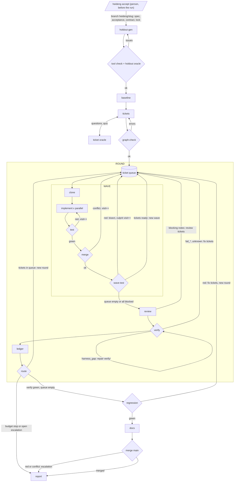

# Heideng - Specification

Heideng (黑灯工厂, hēidēng gōngchǎng, "lights-out factory") is a CLI that develops software from a spec with no people during the run. A person approves the spec before the run and reads the report after. In between, a fixed-graph pipeline produces code, verifies it against holdout scenarios that the development agents cannot see, and merges it into `main` only if verification passes.

- Input: an approved spec. Output: code merged into `main` and a report.
- A run works one spec on one project (a git repo). A project has at most one active run.
- Graph, prompts and skills belong to heideng. The project configures model and effort per node in `heideng.yaml` and customizes the phases with its own `CLAUDE.md`.
- Agents run only on Claude Code.

## References

- Level 5 "dark factory" from Dan Shapiro's [The Five Levels](https://www.danshapiro.com/blog/2026/01/the-five-levels-from-spicy-autocomplete-to-the-software-factory/); holdout scenarios invisible to the agents from StrongDM's [Software Factory](https://factory.strongdm.ai).
- Skills and working vocabulary (`to-tickets`, `tdd`, `code-review`, dark factory) from Matt Pocock's [skills](https://github.com/mattpocock/skills) and [AI Coding Dictionary](https://www.aihero.dev/ai-coding-dictionary/dark-factory).

## Principles

1. **The engine decides the path, the agent does the work.** Routing between nodes is deterministic code that evaluates outcomes, counters and budgets. Inside a node the agent works with its own tool-call loop and returns structured output. The same state always produces the same route, and a run restarts from any node boundary.
2. **Every loop has two stops.** The success stop comes when a check other than whoever did the work judges it done. The budget stop closes the loop with a written reason. Retries (`retries`) repeat a node only on transient errors. Every loop in the graph (ticket visits, rounds, run, progress between rounds) has its own limit. Every stop produces a `stop` event and a line in the report.
3. **The worker cannot see or change its verifier.** The project's tests give the worker an immediate signal inside its loop. Holdout scenarios decide "done", and the worker neither sees nor modifies them. A worker that sees its own verifier optimizes the verifier instead of the goal.
4. **The cheapest check able to settle the outcome decides.** The engine runs deterministic code first (exit codes, hashes, traceability, parsing), then an LLM judge for what code cannot assess. Judges run on a model different from the worker's and start from a clean context. Workers and judges come from the same family and fail in partly correlated ways, so the deterministic checks decide "done" (replay exit codes, traceability, `.heideng/test`). More retries do not fix a judge with false positives.
5. **The node boundary is the unit of durability.** After every node the engine saves state and output; a crash loses only the node in progress, which restarts from scratch on resume. Useful state lives in files, never only in a model's session. Every side effect inside a node is repeatable (check-then-act, deterministic keys).
6. **Work without judgment goes into tool nodes.** Clone, test, merge, bisect, traceability, ticket templates, ledger and route are engine code and cost zero tokens.
7. **The metric is cost per verified AC.** It is the total cost divided by the number of ACs that pass the holdout. It explains why a cheaper model can make the pipeline more expensive (more visits, rounds and failed runs) and guides budget calibration.

## Glossary

| Term | Meaning |
|---|---|
| Spec | Free-form document describing the change. After the gate it lives in `.heideng/specs/<slug>/spec.md` |
| Active spec | Spec whose run was merged into `main`. Only active specs count for baseline, regression and superseded ACs |
| AC | Acceptance criterion with a stable id (`AC-1`), extracted by the gate into `acceptance.md` |
| Contract | `contract.md`: how the software is started, driven and observed (Run, Drive, Observe) |
| Holdout | `verify` skill, scenarios and replays generated from spec and contract, invisible to the worker |
| Scenario | Natural-language acceptance test (intent and assertions) tied to one or more ACs |
| Replay | Executable test (Playwright or script) of a scenario |
| Ticket | Unit of work for an implement agent. Id prefix by origin: `T-<NN>` Ticket from the tickets node, `F-<n>` Fix from verify and regression, `R-<n>` Review from blocking notes |
| Plan | Ticket breakdown approved by the ticket oracle, with its decisions and merge ledger. It belongs to a `spec.lock` version, and every run on that version executes it |
| Visit | One pass of a ticket through implement + test |
| Wave | Tickets whose dependencies are already merged, run in parallel (at most `parallel`) |
| Round | Waves repeated until the queue is empty or the remaining tickets are all blocked, then review and verify |
| Run | Full execution of the pipeline on a spec |
| Answerer | Whoever answers a node's questions. The person in the gate, the ticket oracle in the tickets node, the responder elsewhere |
| Oracle | LLM judge. The holdout oracle assesses the scenarios, the ticket oracle assesses the ticket breakdown |
| Uncovered | Answer or decision that spec and contract do not settle. The run uses a default and reports it |
| Escalation | Problem the run cannot solve on its own and hands to the person |
| `exec` | Deterministic key of a node execution. Inside rounds `r<n>/w<n>/<node>/<ticket>/v<n>` (`r2/w1/implement/F-1/v2`), `r<n>/review`, `r<n>/verify`; outside `gate/v<n>`, `holdout-gen/v<n>` (each oracle pass or harness repair increments `v`), `baseline`, `tickets/v<n>`, `regression/v<n>`, `docs`, `merge-main`, `report`. Names the `nodes/<exec>/` folder and is the idempotency key |
| `attempt` | Execution number of the same `exec` after a resume |

## Architecture

- Standalone CLI in TypeScript (Node or Bun) with a fixed graph in code.
- `tool` nodes are engine code, cost zero tokens and are idempotent. `llm` nodes run `claude -p` in a container (podman or docker). The gate is an `llm` node with the person as answerer, before the run.
- State lives in files under `~/.heideng/<project>/`.
- A local UI follows the run and shows its result. It does not write run data; actions go only through `control.jsonl`.

### Graph



| Node | Type | What |
|---|---|---|
| gate | llm | `heideng accept`: completes the spec, extracts the ACs, writes `spec.lock`; answerer: the person in the terminal |
| holdout-gen | llm | `verify` skill, scenarios and replays from spec and contract; then tool check and holdout oracle |
| baseline | tool | replays of previous specs on `main`; excludes red ones from regression and notes them |
| tickets | llm | `/to-tickets`; questions and quiz go to the ticket oracle |
| graph-check | tool | graph, AC coverage, bootstrap, conformance to the approved quiz |
| clone | tool | `git clone --local` per ticket |
| implement | llm | in parallel, one container per ticket |
| test | tool | `.heideng/test` in the clone, real exit code |
| merge | tool | sequential `--no-ff`; a conflict puts the ticket back in the queue |
| wave-test | tool | tests once at the end of the wave; bisect if red |
| review | llm | `code-review`, then `ponytail-review`; blocking notes become tickets |
| verify | tool + llm | replays, verify agent, evidence check |
| ledger | tool | ticket status, decisions, costs |
| route | tool | chooses between new round, regression and stop |
| regression | tool | replays of active specs, minus the ones red in baseline |
| docs | llm + tool | `README.md` and `docs/` from contract and run diff; non-blocking |
| merge main | tool | `git merge --no-ff heideng/<slug>` into `main` |
| report | tool + llm | `report.md`; the llm writes only the summary |

Every budget stop and escalation leads to report. Inside a round the engine records the escalation, finishes the round (merge of the green tickets, review, verify) and route stops the run. Outside rounds (holdout-gen, tickets, regression, merge main) the run stops immediately. Loop limits are in the [Stop](#stop) table.

Fix tickets (from verify and regression) and review tickets enter the queue of the next round.

### llm nodes

| Node | Sees | Output | Skill | Role |
|---|---|---|---|---|
| gate | spec, `contract.md`, `acceptance.md` of active specs | gaps and proposals, `acceptance.md`, superseded ACs | - | worker |
| holdout-gen | spec, `contract.md`, `acceptance.md`, active holdout | `verify` skill, scenarios, replays | `create-` / `maintain-verification-skill-from-spec` | worker |
| holdout oracle | scenarios, replays, `acceptance.md` | `{ ok, issues[] }` | - | judge |
| tickets | spec, `contract.md`, `acceptance.md`, clone of the integration branch (writes only in `.scratch/`) | ticket files in `.scratch/<slug>/issues/` | `to-tickets` ([mattpocock/skills](https://github.com/mattpocock/skills)) | worker |
| ticket oracle | `to-tickets` questions and quiz, spec, `contract.md`, `acceptance.md`, `decisions.md`, read-only repo | `{ ok, issues[], answers[] }` | - | judge |
| implement | its own clone read-write, dependency cache; in the prompt ticket, spec, `contract.md`, `acceptance.md`, `decisions.md` | `{ status: done\|blocked\|needs_input, questions[], summary, decisions[], skipped[] }` | `tdd`, `diagnosing-bugs` (mattpocock/skills); `verification-before-completion` ([obra/superpowers](https://github.com/obra/superpowers)) | worker |
| review | read-only clone of the integration branch, round diff, spec, `acceptance.md` | `{ notes[] }` | `code-review` (mattpocock/skills); `ponytail-review` ([DietrichGebert/ponytail](https://github.com/DietrichGebert/ponytail)) | judge |
| verify | read-only holdout, app URL, `heideng-exec` to the app container | verdicts per scenario | `verify` (generated); driver [playwright-cli](https://github.com/microsoft/playwright-cli) | judge |
| docs | spec, `contract.md`, `acceptance.md`, `decisions.md` of the run and of active specs, diff `main...heideng/<slug>`, clone of the integration branch (writes only `README.md` and `docs/**`) | `{ status, summary, files[], getting_started_runnable }` | - | worker |
| responder | spec, `contract.md`, `acceptance.md`, `decisions.md` of the run and of active specs, questions; read-only repo, except for holdout-gen questions | `{ answers[] }` | - | answerer |

Only holdout-gen and verify mount the holdout. The `T-01` bootstrap is an implement that runs in `heideng-base`.

## Spec, ACs and contract

### Spec

The spec comes from a writing process outside heideng, in free form. The gate checks that it contains what the holdout needs to drive and observe the software.

### ACs

`.heideng/specs/<slug>/acceptance.md` is the single reference for traceability, tickets and scenarios.

- An AC has one or more scenarios.
- A scenario has at most one replay; the verify agent drives the ones without a replay.
- Tickets cite ACs, never scenarios.

| Level | Where it lives | Who writes it | Example |
|---|---|---|---|
| AC | `acceptance.md` | gate, confirmed by the person | `AC-4`: an expired share link does not open the note |
| AC-0 | `acceptance.md` | gate, from template | `AC-0`: the Run section of the contract works: start, ready signal, seed, Drive reachable |
| Scenario | `holdout/scenarios/<spec>/` | holdout-gen | `notes-03`: create a share, let it expire, open `/s/:token`, expect 410 and note not visible |
| Replay | `holdout/replays/<spec>/` | holdout-gen | `notes-03.spec.ts` |

### Contract

`contract.md` lives in the repo and is cumulative. Each spec changes only the parts it touches. The delta enters `main` only with the run's merge, so `main` always describes existing software.

- **Run.** Port, ready signal (e.g. `GET /health`), env variable names (values live outside the repo, see [App secrets](#app-secrets)), seed (endpoint or command). The start command lives in the project image (`CMD` or `.heideng/start`), so Run stays stack-independent.
- **Drive.** Routes, commands, endpoints. For UIs: labels, roles, visible text and mandatory `data-testid`. If a scenario depends on time (expirations, cron), Drive declares the time control (endpoint or env variable); without it, the scenario is `fail_contract`.
- **Observe.** Expected evidence: output, files, DB rows, side effects.

For web apps replays use user-facing Playwright locators (`getByRole`, `getByLabel`, `getByText`, `getByTestId`) written from the contract without seeing the UI; Playwright's auto-wait handles waiting. If a locator does not find the element the verdict is `fail_contract`. The scenario stays unchanged and implement adapts the code to the contract.

### Gate: `heideng accept <spec>`

The gate is the only step of a spec where a person takes part. The node uses the same mechanism as the other llm nodes (see [Questions and answerers](#questions-and-answerers)). On `needs_input` heideng shows proposals and questions in a TUI (see [`accept`](#accept)), collects the person's answers and resumes the session with `--resume`.

1. Checks the spec with the Run / Drive / Observe checklist: verifiable behaviors, contract delta for each section.
2. For each gap it proposes an addition; the person confirms or corrects.
3. Extracts the ACs with stable ids into `acceptance.md`. On the project's first spec it adds `AC-0` from template.
4. Compares with the ACs of active specs and lists the superseded ones (`spec-A/AC-3` modified or removed).
5. On confirmation it creates the `heideng/<slug>` branch from `main` and commits to it the completed spec in `.heideng/specs/<slug>/spec.md`, `acceptance.md`, the delta applied to `contract.md` and `.heideng/specs/<slug>/spec.lock`: version, hashes of `spec.md`, `acceptance.md` and `contract.md`, plus the list of superseded ACs.

`heideng run` rejects a spec without a lock, with a lock that differs from the files on the branch, with a `heideng/<slug>` branch that does not start from `main`, with `heideng/<slug>` checked out in the project repo, or with a run of the same spec already merged on the current `spec.lock`. `heideng resume` rejects `heideng/<slug>` checked out in the project repo. Every rejection happens before any node runs.

A `heideng accept` with an open run on the same spec adds a commit on the branch and increments the lock version; the report states the round in which the lock changed. The open run keeps its tickets and the spec's saved plan is discarded.

A `heideng accept` with no open run on the spec:
- last run of the spec not merged (failed, aborted, closed): starts from the existing `heideng/<slug>`, keeps its commits and increments the lock version. The plan of the previous version is no longer valid, so the next run plans again on top of the code on the branch;
- last run merged: rejected, the branch belongs to a merged run.

A new `heideng accept` is the only way to plan a spec again.

## Holdout

holdout-gen generates the holdout from spec, contract and `acceptance.md`, in a container with no access to the repo.

```
~/.heideng/<project>/holdout/
  verify/                 skill: SKILL.md (Launch, Doctor, Drive, Evidence, Cleanup) + features/*.md
                          Launch and Doctor describe how the engine starts the app (URL, seed users); they contain no start commands
  scenarios/<spec>/*.md   intent + assertions, each scenario with AC-id      (hash)
  replays/<spec>/*        Playwright / script, one per scenario where possible (hash)
  retired/<spec>/         retired scenarios and replays, with the reason
```

### Generation

- `create-verification-skill-from-spec` on the project's first spec: creates `verify` skill, scenarios and replays.
- `maintain-verification-skill-from-spec` on later specs: works on the contract delta and on the superseded ACs listed in `spec.lock`.
  - Modified AC: rewrites scenario and replay, with a new hash.
  - Removed AC: moves scenario and replay to `retired/<spec>/` with the reason.
- Drivers fixed by heideng, installed in `heideng-verify`, declared in the holdout-gen prompt and used by the Drive section of the `verify` skill:
  - web app: headless playwright-cli, with accessibility snapshots, contract locators, traces and screenshots as evidence. The official playwright-cli skill is in the image, so the `verify` skill names drivers and scenarios and omits commands;
  - API: `curl` on the internal network;
  - CLI: the commands of the Drive section, run in the app container through `heideng-exec` (helper in `heideng-verify`), both by replays and by the agent.
- The spec is the source of truth, so a difference between app and `verify` skill is a product defect. During a run the skill changes only to repair a `harness_gap`.

### Checks after generation

- Tool:
  - traceability: every AC has at least one scenario and every scenario cites existing ACs;
  - parsing: replay typecheck, `playwright test --list`;
  - skill: frontmatter and sections present.
- Holdout oracle: AC coverage and non-trivial assertions. This check catches empty or trivial scenarios. With `maintain` it judges the scenarios and replays of the added and modified ACs plus AC coverage of the whole `acceptance.md`; scenarios of unchanged ACs keep the verdict they already have.
- A tool check that cannot run (the tool exits with a usage or configuration error before reading the holdout, missing image or binary) is an engine `error`, exit code 4, with the tool output in the message. It never returns as `issues` to holdout-gen and never counts toward `oracle_rounds`, because no change to spec, contract or holdout fixes it.

### Reuse

- When the holdout oracle returns `ok`, the holdout manifest records the `spec.lock` hash it was validated for.
- At the start of a run holdout-gen and the holdout oracle are skipped when all three hold: the manifest is validated for the current `spec.lock` hash, no AC of the spec is added, modified or removed, and the hashes of scenarios and replays match the manifest. The skip is an event of the run. Otherwise holdout-gen runs as above.

### Immutability

Inside a run scenarios and replays are immutable. The engine rechecks their hashes and verify runs them without playwright-cli's test generation and repair features. Between specs they change only through gate and holdout-gen. Baseline and regression use only active scenarios.

## Tickets

### Plan

The ticket breakdown belongs to the accepted spec version, and runs execute it.

| Rule | Detail |
|---|---|
| Location | `~/.heideng/<project>/plans/<slug>/`, outside the project repo |
| Key | hash of the whole `spec.lock` file, version included. Every `accept` produces a new key, also with identical content |
| Content | the approved `T-<NN>` tickets, the bootstrap flag, the ticket-gate decisions, the product decisions, the merge ledger, the run that produced it |
| Written | right after the ticket oracle approves the breakdown, before the first wave |
| Product decisions | every `uncovered` decision and every responder answer is appended as it is taken, whatever the state of the ticket that took it. Later runs receive them in `decisions.md` |
| Not in the plan | tickets written by the engine (`F-<n>`, `R-<n>`): they belong to the run that wrote them |
| Valid | the stored key equals the hash of the current `spec.lock` |
| Discarded | a different key replaces the whole plan; `accept` with an open run; `heideng close --delete-branch` |

Merge ledger:
- When the integration branch reaches the project's `heideng/<slug>`, the plan records `T-<NN> -> <sha of the merge commit>` for every plan ticket merged there.
- A plan ticket is done when the ledger has its sha and `git merge-base --is-ancestor <sha> heideng/<slug>` holds. A ticket whose sha is no longer an ancestor (branch reset or rewritten) is queued again.

A run that finds a valid plan skips the tickets node, the ticket oracle and graph-check. Its ticket state starts from the plan: done tickets `merged`, the others `queued`. `T-01` is the bootstrap only while it is not done. The report states the run the plan comes from.

### Ticket files

- The engine writes tickets to `runs/<run>/tickets/<id>.md`; after creation they are immutable.
- Status and visit live only in `run.json` and only the engine changes them.
- All tickets, including those written by the engine, use the body of the `to-tickets` local markdown format.
- Parallelism in a wave ignores touched paths. Merge, requeue and bisect resolve overlaps.

```yaml
---
id: T-04
title: "Share via link"
ac: [AC-4]
deps: [T-02]
source: tickets        # tickets | verify | review | regression
supersedes: F-1        # engine tickets only: the previous round's ticket on the same scenario or note
---
Body of the to-tickets file: What to build, Blocked by, acceptance criteria.
```

### Tickets node

1. The engine creates a clone of the integration branch, puts `docs/agents/issue-tracker.md` (local markdown tracker) in it and declares it in the prompt.
2. The agent runs `/to-tickets <spec>`, which writes one file per ticket in `.scratch/<slug>/issues/<NN>-<slug>.md`. heideng's prompt adds the rules:
   - every ticket has a `**Covers:** AC-1, AC-2` line with the ids from `acceptance.md` (`**Covers:** AC-0` for the bootstrap);
   - the quiz shows the Covers line and the acceptance criteria for each ticket;
   - the clone may already contain part of the work: the breakdown covers only what the spec still requires on top of the existing code;
   - without `.heideng/Dockerfile` in the repo, `01` is the bootstrap and every other ticket depends on `01`. The bootstrap contains only stack, `.heideng/Dockerfile`, `.heideng/test`, `.heideng/build`, `.heideng/start`, a runnable skeleton and a smoke test; domain foundations (models, identity, base pages) are tickets of their own.
3. The skill's questions, quiz included, go to the ticket oracle.
4. The engine converts the files: `id` = `T-<NN>` from the file number; `deps` from the tickets cited in "Blocked by"; `ac` from the Covers line; body unchanged.
5. Graph-check.
6. The approved breakdown becomes the spec's plan.

The node runs only when the spec has no valid plan.

### Ticket oracle

- Answers all `to-tickets` questions, including the breakdown approval quiz (step 4 of the skill), before the skill writes the files.
- On the quiz it returns `ok` and `issues`, without citations, because approval is a judgment. The skill takes the issues into its own flow ("iterate until the user approves") and proposes the breakdown again.
- Applies `too_big` to every ticket, bootstrap included.
- `answers[]` contains only the answers to factual questions, with the responder's rules (see Questions and answerers). Citations come only from spec, `contract.md`, `acceptance.md` or `decisions.md`.

```json
{ "ok": false,
  "issues": [{ "ticket": "04", "kind": "too_big|ac_shallow|missing_dep|test_only|vague", "msg": "..." }],
  "answers": [{ "question": "...", "answer": "...", "source": "verbatim quote", "uncovered": false }] }
```

| kind | Meaning |
|---|---|
| `too_big` | cannot be completed in one visit |
| `ac_shallow` | the ticket cites the AC but its body does not cover it |
| `missing_dep` | undeclared implicit dependency |
| `test_only` | tests only, no behavior |
| `vague` | no local way to tell it is done |

### Graph-check (tool)

- The graph is acyclic and every dependency exists.
- Every ticket has a valid Covers line, at least one ticket covers every AC, and no ticket cites nonexistent ACs. `review` tickets and fix tickets may have no ACs. The bootstrap covers `AC-0`; without a bootstrap, a ticket of its own covers it.
- Without `.heideng/Dockerfile`: `T-01` is the bootstrap and every other ticket depends on it, also indirectly.
- Titles, "Blocked by" and Covers of the files match the breakdown approved by the oracle in the last quiz.
- If it fails, the engine resumes the `to-tickets` session with the errors; if the session is lost, the node restarts from scratch.

### Tickets written by the engine

The engine writes from templates, at zero tokens:
- fix tickets, from verify verdicts and from broken replays in regression. They contain only what the worker may know: scenario id and short reason, or the missing contract element;
- `review` tickets (`R-<n>`), from `blocking` notes. They go through graph-check.
- An engine ticket is valid for one round. If the same scenario or note recurs in the next round, the engine writes a new ticket with `supersedes` and, in the prompt, the `summary` of the previous one. `max_visits` counts attempts within a round, `stall_rounds` the rounds without progress on the holdout.

## Execution

### Clone

- The gate creates the integration branch `heideng/<slug>` from `main` with the commit of spec and contract.
- Each ticket has a `git clone --local` (hardlinks) of the integration branch in `runs/<run>/clones/<ticket>`, on branch `heideng/<slug>@<ticket>`. The agent sees only its own repository, with `git diff` and `git log`.
- The engine collects the work with `git fetch <clone> heideng/<slug>@<ticket>`.
- Before each visit the engine runs `git fetch origin heideng/<slug>` in the clone, so the agent finds `origin/heideng/<slug>` up to date.

### Implement

- Image `heideng-<project>:<hash>`, or `heideng-base` for the `T-01` bootstrap. Mounts: clone on `/work` read-write, volume `heideng-<project>-<pm>` for the dependency cache.
- Prompt: ticket, spec, `contract.md`, `acceptance.md`, `decisions.md`. With `visit > 1` it adds the compressed output of the red tests or the conflict note. Fix tickets use the template.
- Every visit is a new session. Its context is the clone with the diff, the ticket and the compressed test output.
- `decisions[]` are the choices the worker made where ticket and documents do not decide; the engine writes them to `decisions.md` as `uncovered` and to the report.
- Skills:
  - `/tdd`, invoked in the prompt. It first agrees on the seams (the question goes to the responder), then cycles from red to green one slice at a time;
  - `verification-before-completion`: `done` requires the output of the tests rerun in the visit;
  - `diagnosing-bugs`, invoked in the prompt with `visit > 1` for red tests.
- `skipped[]` lists what the agent did not do or did not verify; it ends up in the report.
- After the node the engine runs `git reset --soft <visit base>` and a single commit of the working tree, only if the clone has changes. That commit absorbs any commits the agent made.
- If the visit diff touches `.heideng/test`, `.heideng/build`, `.heideng/start` or `.heideng/Dockerfile` outside the bootstrap, the engine flags it in the review prompt as a mandatory note and in the report.
- With `blocked` the engine marks the ticket `escalated`, blocks its dependents and opens an escalation.

### Test (tool)

- New container, same image and same clone; runs `project.test`, or `.heideng/test` if not set. Only the exit code the engine observes counts.
- With `project.test` set, the bootstrap and implement prompts state the command used and that `.heideng/test` is not run. The same holds for `project.build` and `project.start`.
- If red, the engine increments `visit` and relaunches implement on the same clone, with the compressed output in the prompt. Beyond `max_visits` the ticket becomes `failed`, its dependents stay blocked and the engine opens an escalation.
- Compression, at zero tokens: only failed tests with message and stack trace, repeated lines collapsed; if the format is not recognized, the tail of the output. The full output stays in `nodes/<exec>/`.
- Every tool node that runs project code (test, build, wave-test, replay, getting started) has `budgets.tool_timeout`; when it expires the outcome is red with the note "timeout".

### Merge and wave-test (tool)

- Sequential merge in topological order, then by id: `git merge --no-ff`, one merge commit per ticket.
- On conflict the engine runs `git merge --abort` and puts the ticket in the next wave with `visit++` and the note "conflict with T-x". Implement runs `git merge origin/heideng/<slug>` in the clone and resolves.
- If a merge touches `.heideng/Dockerfile` or a lockfile, the engine rebuilds the image before the wave-test.
- The wave-test runs the tests once at the end of the wave. If red, the engine bisects the wave's merge commits (`--first-parent`), finds the first red merge, runs `git reset --hard` to the previous commit, re-merges the following tickets and retests. The culprit goes back to the queue with `visit++` and the test output.

### Review (one per round)

- Diff `base_round..heideng/<slug>`, in a container on a read-only clone of the integration branch. `base_round` is the branch sha at the start of the round, saved in `run.json`; in round 1 it is the gate commit.
- Two passes in sequence, each in a new session:
  1. `code-review`, Standards and Spec axes, with spec and `acceptance.md` as reference;
  2. `ponytail-review` in report mode, looking for unnecessary complexity. It receives the notes of the first pass and does not repeat them.
- Output: `{ notes: [{ axis: standards|spec|lean, severity: blocking|minor, msg, files[] }] }`.
- Severity, defined in heideng's prompt:
  - `blocking`: on the `spec` axis, a missing or wrong requirement and every bug; on the `standards` and `lean` axes, complexity that blocks later tickets;
  - `minor`: everything else (style, names, local simplifications).
- In round 1 every `blocking` note becomes a `review` ticket. From round 2 only the `blocking` notes on the `spec` axis. All other notes go to the report. Quality notes reopen work at most once per run. A missing requirement reopens it every round.
- Every code change goes through implement, hence through TDD, tests and verify.

### Verify

| Step | Type | What |
|---|---|---|
| 1 Start | tool | Build from the integration branch, app container on the internal network, wait for the ready signal, seed (endpoint called by the engine or command run in the app container); all from the Run section of the contract. Baseline and regression use the same code |
| 2 Replay | tool | Runs the replays, each on clean state (app container restart and seed); the outcome is the exit code; collects traces and screenshots |
| 3 Agent | llm | `verify` skill: drives the scenarios without a replay, one per clean state, assesses non-binary evidence, classifies failures |
| 4 Check | tool | Every scenario has a verdict, every verdict has evidence at the declared path and is consistent with the replay exit code |

The replay exit code is a ceiling for the judge:
- red replay: the agent chooses among `fail_product`, `fail_contract`, `harness_gap`, `unknown`; a `pass` is rewritten to `fail_product` and noted in the report. `harness_gap` requires evidence from step 1 (start or doctor), otherwise it becomes `unknown`;
- green replay: the agent can lower to fail with evidence, never raise;
- scenario without replay: the verdict is the agent's.

The engine reruns a red replay once on clean state. Two reds count as a fail. Red then green is `flaky` in the report and counts as `pass` for route. The third `flaky` of the same replay in a run becomes `harness_gap`.

```json
{ "scenario": "notes-01", "ac": ["AC-1"], "verdict": "pass|fail_product|fail_contract|harness_gap|unknown",
  "reason": "short", "evidence": ["runs/<run>/evidence/notes-01/step3.png"] }
```

| Verdict | Engine | What implement sees |
|---|---|---|
| `pass` | - | - |
| `fail_product` | fix ticket | scenario id + short reason |
| `fail_contract` | fix ticket | missing contract element |
| `harness_gap` | holdout-gen repairs with `maintain-...-from-spec`, then reruns | nothing |
| `unknown` | counts as failure | scenario id |

Repairing a `harness_gap` touches only `verify/` (Launch and Doctor descriptions, Drive helpers). A failing start or seed is a contract or product defect, not a skill defect.

### Baseline and regression (tool)

- Baseline runs at the start of the run and replays the previous active specs on `main`. The engine excludes the red ones from regression and notes them in the report.
- Regression replays all active specs. The current spec's replays run in verify. If red, the engine writes fix tickets for the broken replays and opens a new round within `max_rounds`. Beyond the limit the run stops with an escalation.

### Docs (llm + tool)

- Runs once per run, after green regression, in a container on a clone of the integration branch.
- The agent works with the prompt `prompts/docs.md`, without skills. On the project's first spec the agent creates `README.md` and `docs/`. On later specs it updates only the parts touched by the contract delta and by the diff `main...heideng/<slug>`.
- `README.md` explains the project at a high level, with a getting started, a quick usage and a link to every file in `docs/`.
- The agent chooses topics and file names in `docs/`, for example commands, endpoints and configuration.
- Start, commands and endpoints come from `contract.md`, the rest from the code.
- Tool check:
  - the diff touches only `README.md` and `docs/**`;
  - relative links point to existing files and every file in `docs/` is reachable from the README;
  - every cited endpoint (`METHOD /path`) appears in `contract.md`;
  - with `getting_started_runnable: true` the engine runs the getting started code block in a new container of the project image. The check passes with exit code 0 or, if the block starts the app, with the ready signal of the contract's Run section. With `false` the report flags the getting started as unverified.
- If the check passes, the engine commits on the integration branch. If it fails, or if the node runs out of budget, the engine discards the changes and writes the reason in "To do for you". In both cases the run proceeds to the merge into main.

### Merge into main (tool)

- After the docs node the engine runs `git merge --no-ff heideng/<slug>` into `main`.
- Before the merge the engine commits the run's `decisions.md` to `.heideng/specs/<slug>/decisions.md` on the branch, so later specs read it together with `contract.md`.
- If `main` moved during the run, the engine merges `main` into `heideng/<slug>` and repeats tests and regression. With red tests or a conflict it opens an escalation and leaves the branch unchanged.
- A stopped run leaves the `heideng/<slug>` branch to the person.

## Questions and answerers

`claude -p` has no tool for asking the user questions. heideng turns every skill question into a structured outcome and has the node's answerer resolve it.

- The output schema of every `llm` node has the `needs_input` status with `questions[]`. heideng's system prompt requires that when a skill asks the user, the node stops with `needs_input` and includes the proposal it asks confirmation for.
- On `needs_input` the engine runs the node's answerer (the person in the gate, the ticket oracle in the tickets node, the responder elsewhere), then resumes the session with `--resume <session_id>` and the answers in the prompt.
- The engine removes containers at the end of each attempt, so sessions live outside them. Every node execution has its own Claude Code config dir `nodes/<exec>/claude/`, created before the first attempt and mounted read-write in each container of that execution as `CLAUDE_CONFIG_DIR`. A tickets pass that resumes the previous pass's session (graph-check errors) mounts the dir of the first pass.
- The engine saves every question and answer of an execution in `nodes/<exec>/qa.json` as soon as the answerer gives it. A rerun of the same execution (resume, `accept` after an error) starts from the saved answers and asks only the open questions.
- When the session is gone (crash, `No conversation found with session ID` on `--resume`), the next attempt restarts from scratch with the node's full prompt plus every answer already given to that node, previous passes included. The failed resume counts as one attempt; the from-scratch restart happens at most once per execution.
- Every question with its answer goes to `decisions.md` and to the `question` event. `uncovered` answers end up in "To do for you" in the report.

### Responder

The responder answers on behalf of the product owner, using only the documents it sees.

```json
{ "answers": [{ "question": "...", "answer": "...", "source": "verbatim quote", "uncovered": false }] }
```

- `source` is a verbatim quote from the documents that justifies the answer.
- If the documents do not settle the answer, the responder sets `uncovered: true` with empty `source` and answers with the most conservative default, labeled "default not covered by the spec".
- It approves proposals consistent with the documents and challenges the others with a specific objection.

### Citation check (tool)

Every non-empty `source` must appear verbatim in spec, `contract.md`, `acceptance.md` or `decisions.md` (of the run or of an active spec). `uncovered: true` requires an empty `source`, `uncovered: false` requires a non-empty one. An answer that violates one of these rules becomes `uncovered`.

## Stops, budgets and escalations

### Stop

| Loop | Success stop | Budget stop | `stop` event |
|---|---|---|---|
| Run | holdout and regression green | `usd_per_run`, `wall_clock`, `max_rounds` | `run` / `usd`, `wall_clock`, `max_rounds` |
| Ticket | green tests + merge | `max_visits`: ticket `failed` | `ticket` / `max_visits` |
| llm node | valid output against the schema | `--max-budget-usd`, or timeout + max turns | `node` / `usd`, `timeout`, `turns` |
| Holdout oracle, ticket oracle | `ok: true` | `oracle_rounds` judgments with `ok: false`: run stop with escalation | `run` / `oracle_rounds` |
| Graph-check | all checks pass | `oracle_rounds` passes: run stop with escalation | `run` / `graph_check` |
| Questions | `status` other than `needs_input` | `max_questions` turns per node execution: escalation | `run` / `max_questions` |
| Harness | `harness_gap` repaired | `harness_repairs` repairs per run: escalation | `run` / `harness_repairs` |
| Scenario | verdict other than `unknown` | `unknown` for `unknown_rounds` rounds: escalation | `progress` / `unknown_rounds` |
| Progress | - | same set of failed scenarios for `stall_rounds` rounds: stop with escalation | `progress` / `stall_rounds` |

The docs node has no stop. With a red check or exhausted budget the engine discards the changes and the run proceeds (see [Docs](#docs-llm--tool)).

### `error` and `budget` outcomes of an llm node

- `error` (API, network, container that does not start): the engine repeats the same `exec` with `attempt+1` and backoff, up to `retries` attempts. The cost of interrupted attempts goes to the report. Beyond the limit the engine opens a `run`-level escalation and exits with code 4. These are the retries of principle 2.
- `budget` (usd, timeout, turns): the partial content counts, so the engine does not repeat the node. Route applies the node's fallback:

| Node | Fallback on `budget` |
|---|---|
| implement | like a red test: `visit++`, note "budget exhausted, partial work committed" in the prompt |
| gate, holdout-gen, tickets | escalation, stops immediately |
| holdout oracle, ticket oracle | like `ok: false` |
| responder | all answers `uncovered` |
| review | round without notes, flagged in the report |
| verify (agent) | scenarios without a verdict become `unknown` |
| docs | discards the changes, the run proceeds |
| report | report without summary |

### Escalation

- The engine writes every escalation from a template in `runs/<run>/escalations/<id>.md`: what happened, why, evidence, ways to close it. The status lives in `run.json`.
- Every escalation produces a `stop` event (`level: run`). Route stops the run at the end of the round if it has open escalations; `heideng resolve` closes them and `heideng resume` restarts from the next round.
- `heideng status` lists the open escalations of all the project's runs.
- Ways to close:
  - missing decision: `heideng resolve <id> "note"` writes the note to `decisions.md`, requeues the ticket and resets the `stall_rounds` counter; then `heideng resume` on the same run;
  - spec or contract gap: edit, new `heideng accept` on the same open run (new `spec.lock` version, holdout updated with `maintain-...-from-spec`), then `heideng resume`, which opens a new round. Tickets already merged stay; modified ACs produce fix tickets from verify.
- Resuming after a budget stop requires an explicit extension: `--add-usd 20`, `--add-rounds 2`, `--add-time 2h`.
- Extensions and resolutions produce `control` events and appear in the report.

## State, lock and resume

- Lock `~/.heideng/<project>/run.lock`: a stopped and open run (open escalations, unmerged branch) holds the lock until `heideng resume` completes it or `heideng close` closes it. So every new run starts from a `main` with no pending previous runs.
- After every node the engine writes `run.json` (state and cursor) and the node output in `nodes/<exec>/attempt-<n>/` (`prompt.md`, `response.md`, `status.json`).
- Per-ticket state in `run.json`: `{ status: queued|implementing|tested|merged|failed|escalated|blocked, visit, clone, sha }`. When a ticket becomes `failed` or `escalated`, the engine moves its transitive dependents to `blocked` with the reason; `heideng resolve` brings them back to `queued`.
- `heideng resume` reruns the node in progress with `attempt+1`:
  - `implementing`: `git reset --hard <sha>` and `git clean -fd` in the clone, then implement;
  - `tested`: `git merge-base --is-ancestor <sha> heideng/<slug>` tells whether the merge already happened;
  - review, verify, docs and bisect restart from scratch.

## Events and streams

- `run.json` is authoritative. `events.jsonl` is the log and the UI's SSE feed; on resume the engine ignores events beyond the state in `run.json`.
- The engine is the only writer of `events.jsonl`; nodes are child processes.
- Write order: first the event, then `run.json` (tmp + `fsync` + rename).
- `fsync` on `events.jsonl` for `node.end`, `ticket.status`, `merge`, `verdict`, `stop`, `run.end`, `control`. `stream.jsonl` does not use `fsync`, because the next attempt regenerates a lost tail.
- Before every write (events, stream, `prompt.md`, `response.md`, `status.json`, escalations, report) the engine replaces with `***` the values of the secrets injected into containers (`CLAUDE_CODE_OAUTH_TOKEN`, `ANTHROPIC_API_KEY`, values from `~/.heideng/<project>/env`).

### `events.jsonl` envelope

```json
{ "v": 1, "seq": 812, "ts": "2026-10-17T00:25:11.204Z", "type": "node.end",
  "exec": "r2/w1/implement/F-1/v2", "attempt": 1, "node": "implement", "round": 2, "wave": 1,
  "ticket": "F-1", "visit": 2, "data": { } }
```

- `seq` is monotonic and is the SSE `id` (reconnection with `Last-Event-ID`).
- Context fields live in the envelope, outside `data`, to filter without parsing.
- The UI shows interrupted attempts; the report counts their cost.

### Catalog (v1)

The catalog is closed. A new type requires `v+1`.

| type | data |
|---|---|
| `run.start` | spec, `spec.lock` hash, config hash, heideng version, skill versions, Claude Code version, budget |
| `run.end` | `outcome: merged\|stopped\|aborted\|failed`, reason |
| `node.start` | `kind: tool\|llm`, model, effort |
| `node.end` | `outcome: ok\|fail\|blocked\|error\|budget`, usd, tokens in/out, duration, short summary |
| `ticket.created` | id, title, `source`, deps, ACs |
| `ticket.status` | from, to, reason |
| `merge` | ticket, `ok\|conflict`, sha |
| `bisect` | wave, culprit, reset sha |
| `verdict` | scenario, ACs, round, verdict, reason, evidence[] |
| `harness.repair` | scenario, repair number, outcome |
| `decision` | text, uncovered |
| `question` | questions, answerer, answers, issues, sources, uncovered |
| `escalation` | ticket or scenario, reason |
| `stop` | `level: run\|ticket\|node\|progress`, `kind` ("`stop` event" column of the [Stop](#stop) table), reason |
| `control` | `action: pause\|resume\|abort\|extend\|resolve`, `phase: requested\|applied` |
| `cost` | `run_usd`, `exec_usd` |

- The route decision is read from the next `node.start`.
- Live cost: the engine sums the `usage` of the streams and emits `cost` at most every 15 s or every $0.10 of change. The final value is in `node.end`.

### `nodes/<exec>/stream.jsonl`

- The stream-json of `claude -p`, one line per message, with `attempt` added by the engine.
- The path gives the context; the line number is the SSE `id`.

### Versions

The engine has a TypeScript schema for each version. The server converts old runs to the current version before sending them to the UI.

## Isolation

### Containers

- `container.runtime: podman | docker`, defaulting to the one installed. The engine uses only commands common to both (`run`, `network`, `volume`, `build`).
- The mounts of each node are in the "Sees" column of [llm nodes](#llm-nodes).
- The app under test runs in a dedicated container on an internal network, reachable by verify.
- Credentials reach containers through env or a copy in tmpfs.
- Every container runs as the host user (`--user <uid>:<gid>`, with podman `--userns keep-id`) and with `--cap-drop ALL`, so files written on the mounts belong to the person. `HOME` points to a writable path, because that uid has no home in the image. Volumes the containers write to (dependency cache) are writable by that user from their first use.
- Image builds run as root inside the build and use none of these options.

### Images

| Image | Content | Used by | Produced by |
|---|---|---|---|
| `heideng-base` | git, Claude Code (version pinned by heideng, >= 2.1.277), node, python, go toolchains | `T-01` bootstrap, base of the others | heideng |
| `heideng-verify` | `heideng-base` + Playwright with browsers + playwright-cli with its skill + `heideng-exec` | holdout-gen, verify | heideng |
| `heideng-<project>:<hash>` | `FROM heideng-base` + project stack | implement, test, review, app under test | engine, from `.heideng/Dockerfile` |

- The engine tags `heideng-base` and `heideng-verify` with the hash of their build definition. A heideng change that alters the definition produces a new tag and a rebuild, with no manual removal of old images.
- Every tool installed in the heideng images has a version pinned by heideng (Claude Code, TypeScript, Playwright, playwright-cli). A major release of a tool can change its CLI (TypeScript 7 removed `baseUrl`), and an unpinned version breaks the checks of every run at once.
- Replays import packages installed globally in `heideng-verify` (`@playwright/test`); the image makes them resolvable by standard module resolution from any directory, so typecheck and `playwright test --list` need no path options.
- With docker the engine builds with the classic builder, because BuildKit rejects `--network` to a user network and every build goes through the egress proxy. Podman accepts it.
- `.heideng/Dockerfile` is a repo file, and agents create and modify it like any other file.
- `<hash>` covers `.heideng/Dockerfile` and the lockfiles. The engine rebuilds at the wave boundary when the hash changes.
- Bootstrap: with a repo without `.heideng/Dockerfile`, `T-01` runs alone in the first wave, in `heideng-base`, and creates stack, `.heideng/*` and skeleton. After the merge the engine builds the image. If the spec fixes the stack, the bootstrap respects it; otherwise the choice is a question to the answerer and goes to `decisions.md` as `uncovered`.

### Egress

- A proxy container (domain allowlist, HTTP CONNECT) is the only one with outbound internet access.
- The other containers run on an `--internal` network with `HTTPS_PROXY` pointing to the proxy. A tool that ignores the proxy has no route to the internet. This works with podman and docker, macOS included.
- Node allowlist: provider endpoints and package registries (`container.allow`).
- Agents write the Dockerfile, so the project image build also goes through the proxy, with the allowlist extended to package mirrors (`container.build_allow`).
- `heideng init` derives `allow` from the detected package manager: `api.anthropic.com` plus its registries (npm, pnpm, bun: `registry.npmjs.org`; yarn: also `registry.yarnpkg.com`, `repo.yarnpkg.com`; pip, uv, poetry: `pypi.org`, `files.pythonhosted.org`; go: `proxy.golang.org`, `sum.golang.org`). `build_allow` adds the OS package mirror; builds use `allow + build_allow`.
- The builds of `heideng-base` and `heideng-verify` use an allowlist fixed in heideng (Debian and npm mirrors, Playwright's browser download hosts `cdn.playwright.dev` and `storage.googleapis.com`), independent of the project config.
- The proxy logs every host it refuses. When a build or a node fails, the engine reads the proxy log before stopping it and names the blocked hosts in the error: `-> add <host> to container.build_allow in heideng.yaml` for project images, "report it as a heideng bug" for heideng images. Install scripts download from hosts no table can predict (browsers, prebuilt binaries), so the person extends the allowlist from these errors.

### Credentials

- macOS host: Keychain (`Claude Code-credentials`). In the container: `CLAUDE_CODE_OAUTH_TOKEN` from `claude setup-token` (1 year, Pro/Max) or `ANTHROPIC_API_KEY`. With OAuth heideng runs Claude Code in standard mode, without `--bare`.
- Personal login with the official binary is valid for personal use. Whoever distributes the tool to others uses an API key.

### App secrets

- `.heideng/env` in the repo lists the variable names (`KEY=`), the same as in the contract's Run section. The values live in `~/.heideng/<project>/env`, outside the repo.
- The engine injects them into the app container and the test container. Agents see only the names.

### Parallelism

- `parallel` per node and a global semaphore on agents (`limits.agents`).
- The same `CLAUDE_CODE_OAUTH_TOKEN` runs in N containers; the practical limit is the subscription rate limit.

## Claude Code backend

```ts
run(prompt, { cwd, model, effort, schema, budget, resume? }) -> { output, cost, session_id }
```

- `claude -p --output-format stream-json --verbose` with `--json-schema`, `--max-budget-usd`, `--effort`, `--model`, `--allowedTools` / `--disallowedTools`, `--append-system-prompt`.
- Structured output is the `structured_output` of the `result` message.
- Claude Code loads skills natively. heideng invokes those with `disable-model-invocation: true` in the prompt as a command (`/to-tickets <spec>`).
- `--resume <session_id>` resumes the session after the answerer's answers. The session is found only in the execution's config dir (see [Questions and answerers](#questions-and-answerers)).
- In containers `claude` runs with `--permission-mode bypassPermissions`. In `-p` mode nobody can approve a permission prompt, so any other mode denies writes and compound commands and the node stalls asking where it may write. The container's mounts, network and user limit what the agent can read, write and reach.

### Prompts and skills

- Prompts and system prompts live in `prompts/*.md` in the heideng repo, versioned with heideng.
- The system prompt asks for concise prose in reasoning and replies. Structured output, code and artifacts read by agents or people (tickets, `decisions.md`, review notes, escalations, report) stay complete.
- heideng uses third-party skills unmodified, with versions pinned in `skills-lock.json` of the heideng repo. Updating a skill means updating the lock; `heideng stats` compares runs by version.

### Customization

The project customizes the phases without touching heideng's prompts and skills.

- Claude Code loads the repo's `CLAUDE.md` in the nodes that mount the repo: tickets, ticket oracle, implement, review, docs, responder. Without `CLAUDE.md` it loads `AGENTS.md` (Claude Code >= 2.1.277); with both it loads only `CLAUDE.md`, which can include `@AGENTS.md`.
- heideng's prompt declares the phase ("you are in the review node of Heideng"). `CLAUDE.md` points to one file per phase, which the agent reads only in that phase:

```markdown
## Heideng
- Tickets phase: see .heideng/tickets.md
- Implement phase: see .heideng/implement.md
- Review phase: additional checks in .heideng/review.md
- Docs phase: see .heideng/docs.md
```

- Customizations add to heideng's behavior, and whoever writes them is responsible for them.
- Gate, holdout-gen, holdout oracle, verify and the responder for holdout-gen do not mount the repo and receive no customizations.
- Checks expressible as scripts go in `.heideng/test`.

## Local UI

### Process

- `heideng ui` is a separate process; it reads the run directory and writes only to `control.jsonl`. `heideng run` launches it automatically; the run does not depend on the UI and the UI stays openable after the run ends.
- Actions write to `control.jsonl` (append-only). The engine reads it at the node boundary and confirms with a `control` event (`phase: applied`).
- When paused the engine stays alive and waits at the node boundary. `run.lock` contains the engine's pid.
- The UI binds only to `127.0.0.1`, with a token in the URL against requests from other pages.
- Prompts, tickets and scenarios change only through gate, escalation and `heideng resume`, never from the UI.

### Data

| File | Content | Use in the UI |
|---|---|---|
| `run.json` | state, cursor, tickets | snapshot on open |
| `events.jsonl` | engine events | SSE, reconnection with `Last-Event-ID` |
| `nodes/<exec>/stream.jsonl` | Claude Code stream-json | SSE on demand, with the open node's detail; long tool outputs truncated on screen |
| `nodes/<exec>/attempt-<n>/*` | prompt, response, status | detail |

### Layout: timeline

```
+--------------------------------------------------------------------------+
| notes-sharing  run 2026-10-17-a  [running]  ROUND 2/5 - wave 1            |
| $14.06/50 [===---]  2h38/6h00 [====--]  stall 0/2 [-----]  [Pause][Abort] |
| STOP: <reason>                                    (only if run stopped)   |
+---------------------------------------------+----------------------------+
| TIMELINE        | round 1         | round 2 |  DETAIL                    |
| holdout-gen     ##                          |  (selection)               |
| tickets           #                         |  Stream | Prompt |         |
| merge                 |   |   |      |      |  Response | Diff | Test |  |
| wave-test             |   |   |      |      |  Visits / Cost             |
| review                          ###         |                            |
| verify                             XXXX     |  (no selection)            |
| ledger                                 |    |  Decisions | Stops/escal.|
| - - - - - - - - - - - - - - - - - - - - - - |  Merges | Events           |
| T-01 Note model    ###                      |                            |
| T-02 CRUD API        XX###                  |                            |
| T-07 Search            XXXXXX               |                            |
| F-1 fix notes-03                     XX##>  |                            |
|                                         now |                            |
+---------------------------------------------+----------------------------+
| HOLDOUT  notes-01 [g][g]  notes-03 [r][g]  notes-07 [r][r]  ...           |
+--------------------------------------------------------------------------+
```

- Header: spec, run, state, round and wave, budget bars (`usd_per_run`, `wall_clock`, `max_rounds`, `stall_rounds`), actions. If the run is stopped, a STOP line with the reason.
- Timeline: the axis is run time, alternating bands per round, ticks every 30 minutes with the time.
  - Above the separator the engine nodes (holdout-gen, tickets, merge, wave-test, review, verify, ledger, docs, report); below, one row per ticket with a label colored by state.
  - One bar per execution or visit. Color by outcome: green ok, red failure (red tests, conflict, verify with failures), blue in progress, yellow escalation, gray interrupted attempt. Tooltip with label, times, outcome.
  - During the run: a "now" line and in-progress bars that grow.
  - Click on a row: detail of the node or ticket.
- Detail:
  - ticket: Stream, Prompt, Response, Diff, Test, Visits;
  - llm node: Stream, Prompt, Response, Cost; tool node: Log, State;
  - scenario: Verdicts per round, Evidence (screenshots, Playwright traces), Replay;
  - no selection: Decisions (`decisions.md`, `uncovered` flag), Stops/escalations, Merges/bisect, Events.
  - nodes with questions: a Questions tab from `qa.json`, one entry per turn with question, proposal, answer, source and `uncovered` flag.
- Rendering of the detail panes, so a person reads them without parsing JSON:
  - Stream as a conversation: a header with model, cwd and permission mode (highlighted when it is not `bypassPermissions`); assistant text as markdown; each tool call as a collapsible row with input and result, marked when it failed or was denied; thinking hidden behind a toggle; a filter for errors only; a separator per attempt.
  - Response from the node's output schema: `status` as a colored label, `summary` first, long strings as prose, arrays of objects as cards, a toggle for the raw JSON.
  - Prompt as markdown.
- Holdout strip: for each scenario one square per round colored by verdict. Click: scenario detail.
- Prototype with fake data: `prototypes/df-ui.html`, variant B (`?variant=B`), live and morning modes.

### Actions

| Action | Semantics |
|---|---|
| Pause | at the node boundary: running nodes finish, no new node starts; `paused` in `run.json` |
| Resume | `control` event that restarts the paused engine |
| Abort | immediate stop of the containers, valid `run.json`, branch unchanged, stop "manual abort" in the report |
| Open node | read-only |

### History

- `/runs`: list of runs with spec, outcome, cost, cost per verified AC.
- After the run the run view acts as the report (summary, escalations, stops) and shows `report.md`.

### Stack

- Server: `Bun.serve` / `node:http` inside the CLI. Endpoints: `/`, `/api/run`, `/api/events` (SSE), `/api/node/:exec/*` (stream, prompt, response, status, `qa`), `/api/runs`, `POST /api/control`.
- Frontend: a single HTML file with Preact + htm bundled in the package.

## Report and metrics

`runs/<run>/report.md` is the canonical source. "To do for you" comes first, because it is the section the person reads in the morning.

```markdown
# <spec> - run <id>
Outcome: merged <sha> | stopped: <reason> | aborted | failed
Branch heideng/<slug> - round 3/5 - $27.80 / 50 - 5h12 / 6h

## To do for you
- [ ] T-06 escalation: <reason> -> heideng resolve T-06 "..." | edit contract
- [ ] uncovered decision (T-01): <text>
- [ ] docs not updated: <reason> | getting started unverified

## Holdout
| scenario | AC | R1 | R2 | R3 | evidence |
Excluded by baseline: <list>. Retired by this spec: <list>.

## Tickets
| id | source | outcome | visits | cost |
Skipped or unverified (implement skipped[]): <list per ticket>

## Review
Minor notes per round: | round | axis | note | files |

## Stops
| level | type | reason |

## Decisions
## Costs
per node, per ticket, interrupted attempts, $ per green AC
## Diff
git diff --stat main...heideng/<slug>
## Summary
(llm, 5 lines)
```

- To calibrate budgets the engine collects from `node.end` and the report: cost per node type, per visit, per green AC, interrupted attempts.
- `heideng stats` aggregates the project's reports and computes the cost per verified AC.

## CLI

| Command | What it does | Main flags |
|---|---|---|
| `heideng init` | detects stack, package manager and commands; generates `heideng.yaml` (with the allowlists of the package manager, see [Egress](#egress)), empty `contract.md`, `.heideng/Dockerfile` if the stack is detectable, the Heideng section of `CLAUDE.md`; flags an `AGENTS.md` not included by `CLAUDE.md` | `--force` |
| `heideng accept <spec>` | gate: `heideng/<slug>` branch with `spec.md`, `acceptance.md`, `contract.md`, `spec.lock` | `--plain` |
| `heideng run <spec>` | starts the run and the UI | `--no-ui` |
| `heideng resume [run]` | with a live engine (pid in `run.lock`) writes `resume` to `control.jsonl`; otherwise relaunches the engine on the node in progress | `--add-usd`, `--add-rounds`, `--add-time` |
| `heideng resolve <id> "note"` | closes an escalation with a decision | - |
| `heideng pause [run]` / `heideng abort [run]` | write to `control.jsonl` | - |
| `heideng close <run>` | gives up on a run: closes it and releases the lock; branch and plan stay for the next run. With `--delete-branch` it deletes the branch and the spec's plan and moves the spec's holdout to `retired/` | `--delete-branch` |
| `heideng status` | active run, open escalations | `--all`, `--json` |
| `heideng ui [run]` | opens the UI | `--port` |
| `heideng stats` | aggregated costs across runs | `--json` |
| `heideng clean` | cleanup | `--dry-run` |

An optional skill helps write the first `contract.md`.

Exit codes of `run` and `resume`:

| Code | Meaning |
|---|---|
| 0 | merged into main |
| 1 | stopped with escalation or stall |
| 2 | budget stop |
| 3 | manual abort |
| 4 | engine error |
| 5 | run rejected (invalid spec lock, run already active, branch checked out, spec already merged on this lock) |

Exit codes of the other commands: 0 success, 3 `accept` closed by the person without confirmation, 4 engine error, 5 rejected (invalid arguments, unknown id, unmet precondition, `accept` without TTY).

### Output

Common rules:
- Results go to stdout; live feedback, warnings and errors go to stderr.
- An error is two lines: `error: <what>` and `-> <command or file that resolves it>` (e.g. `error: spec.lock differs from acceptance.md` / `-> heideng accept notes-sharing`).
- With a TTY the output uses colors and redraws in place. Without a TTY or with `NO_COLOR` it has no colors and no redraw, and the live area becomes one line per event (see below).
- `--json` on `status` and `stats` prints a single JSON document on stdout.

#### Live area: `run`, `resume`

During the run stderr shows a live area that the CLI redraws in place, with the current state only:

```
heideng notes-sharing  run 2026-10-17-a  UI http://127.0.0.1:4317/?t=...
ROUND 2/5  wave 1  $14.06/50  2h38/6h00  stall 0/2  escalations 0
 ⠋ implement F-1 fix notes-03 (v2)   Bash: npm test -- notes          3m12  $0.84
 ⠋ implement T-07 Search (v1)        Edit src/search/index.ts         5m40  $1.12
 ⠋ wave-test                         waiting for 2 tickets
last: merge T-02 ok 9f3c2a1
```

- Line 1: spec, run, UI URL with token (without `--no-ui`: no URL). It stays fixed for the whole run.
- Line 2: round and wave, the `usd_per_run`, `wall_clock` and `stall_rounds` budgets, open escalations. Cost updates on every `cost` event.
- One line per running node: spinner, `exec` in readable form (node, ticket, title, visit), current activity, elapsed time, node cost. The line disappears when the node ends.
- Activity of an llm node: the last message of `stream.jsonl`, as tool and main argument (`Edit src/search/index.ts`, `Bash: npm test -- notes`, `Skill /tdd`) or the first line of the assistant text, truncated to the terminal width. On `needs_input`: `asking <answerer>: <first question>`.
- Activity of a tool node: its current step (`replay notes-03 2/9`, `bisect 2/4`, `build heideng-notes:3fa1`, `seed`).
- `last:` the last event among `merge`, `bisect`, `verdict`, `ticket.status`, `stop`, `escalation`, `control`.
- The spinner advances at 10 fps; the text changes on every new message of the streams and every event.
- Without a TTY: one line per `node.start`, `node.end`, `merge`, `bisect`, `verdict`, `stop`, `escalation`, `control` event, in the form `<time> <exec> <event> <outcome> <cost>`.

#### End of run: `run`, `resume`

At the end the CLI clears the live area and prints on stdout:

```
heideng notes-sharing  run 2026-10-17-a  stopped: max_rounds
Branch heideng/notes-sharing  round 5/5  $48.20/50  5h51/6h00
Holdout 11/14 pass  3 fail_product  |  tickets 12 merged, 1 failed  |  $4.38 per verified AC

To do for you
- [ ] T-06 escalation: <reason> -> heideng resolve T-06 "..." | edit contract
- [ ] uncovered decision (T-01): <text>

Inspect
  report       ~/.heideng/notes-sharing/runs/2026-10-17-a/report.md
  UI           heideng ui 2026-10-17-a
  escalations  ~/.heideng/notes-sharing/runs/2026-10-17-a/escalations/
  diff         git diff --stat main...heideng/notes-sharing
  next         heideng resume 2026-10-17-a --add-rounds 2
```

- Line 1: outcome as in `report.md` (`merged <sha>`, `stopped: <reason>`, `aborted`, `failed`).
- "To do for you" is the same list as the report; without items the section is absent.
- "Inspect" lists the report path, the UI command, the escalations path if any, the diff of the branch and the next command consistent with the outcome (`resume` with the extension for the exhausted budget, `resolve`, `close`). On `merged`: the merge sha in place of the diff and no next command.
- The exit code follows the table above.

#### `accept`

- During the gate's work stderr shows the live area with the gate node only.
- The TUI draws on stderr and needs stdin and stderr on a TTY; stdout keeps only the result lines. `--plain` (and a stderr that is not a TTY) uses numbered line prompts on stderr: Enter confirms the proposal, a line of text corrects it, `y/n` confirms the summary. Scripted drives use `--plain`.
- `ctrl-c` on any screen, also while `$EDITOR` is open, closes `accept` with exit code 3 and creates nothing.
- The interactive part is a full-screen TUI on the terminal's alternate screen. It opens on every `needs_input` and on the final confirmation, and closes when the gate session resumes or the commit is done.

Questions screen, on `needs_input`:

```
+- heideng accept notes-sharing --------------------------- gate v2 - 3/5 -+
| ITEMS                    | [Drive] Gap: share link expiration             |
| [x] 1 Run: ready signal  |                                                |
| [~] 2 Drive: expiration  | Spec: "a share link expires after 7 days"      |
| [ ] 3 Observe: 410 body  | Drive declares no time control, so the         |
| [ ] 4 Q: seed users      | expiration scenario cannot be driven.          |
| [ ] 5 Q: max note size   |                                                |
|                          | Proposal                                       |
|                          | Drive: POST /test/clock {now} when             |
|                          | HEIDENG_TEST_CLOCK=1                           |
|                          |                                                |
|                          | Correction                                     |
|                          | > use env FAKE_NOW instead of an endpoint_     |
+--------------------------+------------------------------------------------+
| up/down item  enter confirm  e correct  E $EDITOR  s send  q quit         |
+---------------------------------------------------------------------------+
```

- Left: the gaps (with their Run / Drive / Observe section) and the questions, numbered, with their state: `[ ]` open, `[x]` proposal confirmed, `[~]` corrected.
- Right: the selected item, with the quote from the spec it comes from, the reason for the gap or the question, the proposal and the correction field.
- Keys: `up`/`down` (or `k`/`j`) select; `enter` confirms the proposal; `e` edits the correction inline (multi-line, `ctrl-s` saves, `esc` cancels); `E` opens the correction in `$EDITOR`; `s` sends the answers when every item has one, and the gate session resumes; `q` asks for confirmation and closes `accept` with exit code 3.

Confirmation screen, before the commit:

- Three tabs (`tab` switches): ACs (id and text), superseded ACs (`spec-A/AC-3` with modified or removed), contract delta as a diff per section (Run, Drive, Observe).
- Keys: `y` commits; `e` on an AC or a delta line writes a correction that goes back to the gate session as an answer, then the screen reopens with the new proposal; `q` closes with exit code 3.

After the commit the TUI closes and the CLI prints on stdout: branch, commit sha, `spec.lock` version, paths of `spec.md`, `acceptance.md` and `contract.md`, next command `heideng run <spec>`.

#### Other commands

| Command | Output |
|---|---|
| `init` | detected stack, package manager and commands; created files, each with its path; skipped files that already exist (overwritten with `--force`); a warning for an `AGENTS.md` not included by `CLAUDE.md`, with the line to add |
| `pause`, `abort`, `resume` with a live engine | writes `control.jsonl` and prints `requested`; then shows the live area until the `control` event with `phase: applied` and prints `applied`. Ctrl-C detaches the CLI and the request stays valid |
| `resolve` | closed escalation, note written to `decisions.md`, tickets back to `queued`, next command `heideng resume <run>` |
| `close` | closed run, lock released, clones removed, with `--delete-branch` the deleted branch, the deleted plan and the scenarios moved to `retired/` |
| `status` | active run with state, round, cost and budgets, running nodes; table of open escalations (run, id, reason, command to close it); `--all` adds the closed runs |
| `ui` | URL with token |
| `stats` | table per run (spec, outcome, cost, verified ACs, cost per verified AC) and the project total |
| `clean` | removed items per category (containers, networks, clones, images) with freed space; with `--dry-run` the same list with nothing removed |

## Config

`heideng.yaml` in the repo root:

```yaml
# project.*: written by the person, win over .heideng/test, .heideng/build, .heideng/start; heideng init sets them only if it detects the commands
project: { test: "npm test" }
container: { runtime: podman, allow: [api.anthropic.com, registry.npmjs.org], build_allow: [deb.debian.org, pypi.org, files.pythonhosted.org] }
limits: { agents: 4 }
budgets: { usd_per_run: 50, wall_clock: 6h, max_rounds: 5, max_visits: 3, stall_rounds: 2,
           oracle_rounds: 2, unknown_rounds: 2, harness_repairs: 3, max_questions: 3, retries: 2, tool_timeout: 20m }
nodes:
  gate:        { model: opus }
  holdout_gen: { model: opus }
  tickets:     { model: sonnet }
  oracle:      { model: opus }
  implement:   { model: sonnet, effort: medium, parallel: 4 }
  review:      { model: opus }
  verify:      { model: opus }
  docs:        { model: sonnet }
  responder:   { model: sonnet }
```

## Disk layout

In the project repo:

```
heideng.yaml
contract.md
.heideng/
  Dockerfile  test  build  start
  env                                            app variable names
  tickets.md  implement.md  review.md  docs.md   per-phase customizations (optional)
  specs/<slug>/
    spec.md
    acceptance.md
    spec.lock
    decisions.md                                 committed at the end of the run
```

heideng state:

```
~/.heideng/<project>/
  run.lock
  env                         app variable values
  holdout/                    verify/, scenarios/, replays/, retired/
  plans/<slug>/               plan of the spec: tickets, decisions, merge ledger, spec.lock key
  gate/<slug>/                state of heideng accept, before any run
    events.jsonl
    nodes/gate/v<n>/          same layout as a run's nodes/<exec>/
  runs/<run>/
    run.json
    events.jsonl
    control.jsonl
    decisions.md
    report.md
    tickets/<id>.md
    escalations/<id>.md
    evidence/<scenario>/
    clones/<ticket>/
    nodes/<exec>/
      stream.jsonl
      qa.json                 questions and answers of the execution
      claude/                 Claude Code config dir (sessions), mounted as CLAUDE_CONFIG_DIR
      attempt-<n>/  prompt.md  response.md  status.json
```

## Cleanup

| What | Policy |
|---|---|
| Containers, app and proxy networks | removed at the end of the node or run (`--rm`) |
| Ticket clones | kept while the run is open (needed for resume); removed after the merge into main or `heideng close` |
| `heideng-<project>:<hash>` images | the current and previous ones kept; the others removed at the start of the run |
| `heideng-base`, `heideng-verify` | the ones with the current definition hash kept |
| Dependency cache volume | kept |
| Events, streams, evidence, reports | kept (history, `heideng stats`) |

## Testability

heideng is verified through its binary with `claude` replaced by a stub. Three seams, read from env and absent from `--help` and README:

| Variable | Replaces | Containers | What it proves |
|---|---|---|---|
| `HEIDENG_CLAUDE_BIN` | `claude`, run directly on the host | none | graph, routing, budgets, events, CLI, UI |
| `HEIDENG_RUNTIME_BIN` | the podman/docker binary | recorded, not started | container argv, cleanup |
| `HEIDENG_CLAUDE_STUB_DIR` | only `claude` inside the containers: the dir is mounted at `/heideng-stub` and `/heideng-stub/claude` is the command, with `HEIDENG_NODE` and `HEIDENG_EXEC` in the env | real podman/docker | images, egress proxy and internal network, secrets, mounts, user and permissions, sessions across containers |

- `HEIDENG_CLAUDE_BIN` wins when both claude seams are set. A `HEIDENG_CLAUDE_STUB_DIR` without an executable `claude` rejects `accept` and `run` with exit code 5.
- Container behavior (build behind the proxy, `--internal` network, non-root mounts, cache volume, session persistence) is proven only with `HEIDENG_CLAUDE_STUB_DIR` on a real runtime; the other seams never execute it.
- The stubs reproduce the Claude Code behaviors the engine depends on: a new `session_id` per call stored under `CLAUDE_CONFIG_DIR`, `--resume` of an unknown session fails with `No conversation found with session ID`, the `result` message with `structured_output`, cost and errors. A stub that accepts any `--resume` hides the loss of sessions between containers.
