# Proposal: harness contract, bootstrap smoke, harness failures

Delta to `SPEC.md`. Each section names the SPEC section it changes. "Product" is the software under test, whatever its shape: web app, HTTP API, CLI, daemon or service without UI, desktop app, library.

## Evidence

Runs `splitto 2026-10-22-a`, `splitto 2026-10-23-a`, `splitto-2 2026-10-23-a`, `splitto-3 2026-10-25-a`.

| Fact | Where |
|---|---|
| 0 verify failures caused by the product in the first 3 runs; the real bugs came from review | `splitto/runs/*/report.md` Review, `tickets/R-*.md` |
| Every red round came from the harness: `sh` on a bash script, host `app` under HSTS, `.sh` replays without cwd, no browser in the image, `127.0.0.1` bind, Run section in prose with no ready wait | `runs/2026-10-22-a/evidence/start/start.log`, `runs/2026-10-23-a/evidence/start/doctor-r3-verify.log`, `splitto-2/.../evidence/s01-startup-health/replay.log` |
| The harness failure surfaced after every ticket of round 1 was merged | `events.jsonl`, first `verdict` vs last `merge` in each run |
| The `verify` skill written by holdout-gen described an engine that does not exist (`APP_URL=http://127.0.0.1:$PORT`, testDir, proxy) and was rewritten twice without the engine changing | `splitto-2/holdout/verify/SKILL.md` Launch, `splitto/holdout/verify/SKILL.md` history |
| The gate of splitto-2 added `127.0.0.1` on its own; the person confirmed it; holdout and T-01 enforced it | `splitto-2/gate/splitto-2/nodes/gate/v1/attempt-2/status.json`, `splitto-2.md` (no occurrence) |
| In round 2 the responder refused the `0.0.0.0` fix: "the documents give no authority to override the explicit 127.0.0.1 requirement" | `splitto-2/runs/2026-10-23-a/decisions.md` 70-73 |
| `unknown` verdicts with one shared network error produced 19 and 32 fix tickets, closed "no code change" or with contradicting fixes and a bisect | `splitto/runs/2026-10-23-a/tickets/F-*.md`, `splitto-2/.../events.jsonl` seq 475-506, 580 |
| The verify agent spent its turns installing a browser and a port forwarder, then gave 0 verdicts | `splitto-2/.../nodes/r1/verify/stream.jsonl` 1657-1746 |
| T-13 of splitto-3: 24 consecutive wave-test reds on the same test, bisect culprit each time, 31 visits; cause `npm install` EACCES on a root-owned `/cache/npm` in the wave-test container; the visit patience never fired | `splitto-3/.../events.jsonl` seq 334-861, `decisions.md` 61-84 |
| F-1 of splitto-3: a real assertion failure in the replay, ticket text "the replay is red and the verify agent gave no verdict", implementer escalated for lack of evidence | `splitto-3/.../evidence/html-add-expense-equal-split/replay.log`, `tickets/F-1.md`, `escalations/E-1.md` |
| 40 and 52 `uncovered` decisions per run, all product-level choices the spec leaves open (stack, dependencies, trim, CSV line endings, tie-breaks) | `report.md` "To do for you" |
| 12 of the 40 engine and spec fixes since 21 October encode an environment rule discovered by a failing run | `heideng-2` git log from `ed0447e`, uncommitted diff |

## 1. Surfaces

Changes [Contract](#contract), [Generation](#generation), [llm nodes](#llm-nodes).

A surface is a way the engine reaches the product. The contract's Run section declares the product's surfaces; every scenario drives exactly one. heideng fixes the list, the driver of each, where its replays run and what evidence they leave.

| Surface | Product | Driver, from `heideng-verify` | Replay runs in | `APP_URL` or target | Evidence |
|---|---|---|---|---|---|
| `http` | API, service with an HTTP port | `curl`, Playwright request context | `heideng-verify` | `http://heideng-app:<port>` | request and response logs |
| `browser` | web UI | headless playwright-cli, contract locators | `heideng-verify` | `http://heideng-app:<port>` | traces, screenshots, accessibility snapshots |
| `exec` | CLI, library through its test suite, daemon through its control commands | `heideng-exec`: a command in the product container, from the project directory | product container, `sh` | the project directory, `http://localhost:<port>` when the product also has a port | stdout, stderr, exit code, files the scenario names |
| `files` | anything that writes files, queues, sockets | `heideng-exec` reading paths | product container | paths from the Observe section | file contents |
| `desktop` | GUI app | playwright-cli on the product's web view, or the app's own automation surface named in Drive; a GUI with neither is `fail_contract` at the gate | `heideng-verify` or product container | from Drive | screenshots, traces |

A product with no long-running process (CLI, library) has only `exec` and `files`; its Run section has no port and no ready signal, and "start" means nothing. Readiness and reachability then mean: the container of the product image runs `.heideng/test` with exit 0 and one command of the Drive section with the exit code the contract gives.

## 2. Harness contract

New section after [Isolation](#isolation). Changes: [Gate](#gate-heideng-accept-spec), [Generation](#generation), [Responder](#responder), [Citation check](#citation-check-tool), [Disk layout](#disk-layout).

The harness contract describes how the engine builds, starts, reaches and observes the product. heideng writes it; no node writes or edits it.

```
~/.heideng/harness.md     written by heideng at init and at every heideng upgrade, hash in run.start
```

Content:

- **Build and run.** `.heideng/build`, `.heideng/start` (absent for products with no process), `.heideng/test`: POSIX `sh` with `#!/bin/sh`, run through their shebang when executable, from the project directory. `.heideng/Dockerfile` starts `FROM heideng-base`, no `COPY`, no `CMD`. The product container runs under the alias `heideng-app` on the internal network, as the host user, with the dependency cache volume writable by that user. A product with a port listens on `0.0.0.0` on the port in `PORT`. The engine polls the ready signal from another container.
- **Run section grammar.** One line per value the engine reads; the engine parses only these:
  - `- Surfaces: http, browser` (one or more from the table);
  - `- Port: <n>` (surfaces `http`, `browser`, or `exec` with a port);
  - `- Ready: GET <path>` | `` - Ready: `<command>` `` (exit 0 in the product container) | `- Ready: none` (no process);
  - `- Seed: POST <path>` | `` - Seed: `<command>` `` | `- Seed: none`;
  - `- Env: KEY, KEY`.
- **Verify.** `heideng-verify` contains Playwright with browsers, playwright-cli and `heideng-exec`; it installs nothing at run time; its egress is the engine's allowlist plus `heideng-app` and the exec endpoint. Per surface: target, where replays run, evidence (section 1 table).
- **Replays.** Layout `replays/<slug>/<id>.spec.ts` (surfaces `http`, `browser`, `desktop`) or `<id>.sh` (surfaces `exec`, `files`); checks `tsc --noEmit` and `playwright test --list` from `replays/<slug>` with no config; run `playwright test <file> --output=/evidence/traces` from the same directory; `.sh` with `sh` in the product container from the project directory; evidence root `/evidence`.
- **Evidence the engine captures.** `evidence/start/build.log`, `start.log`, `seed.log`, `doctor.md`; per scenario `replay.log`, traces, screenshots, the stdout and stderr of `.sh` replays. Nothing else: a scenario that reads the product's output reads these files.
- **Clone.** `origin` is a host path, already fetched; no fetch, pull or push.

Readers and uses:

| Reader | Use |
|---|---|
| gate | checklist item: the Run section of the contract delta parses against the grammar and follows the build-and-run rules; a spec line that contradicts them (bind `127.0.0.1`, a `CMD` start, a GUI with no automation surface) is a gap the gate corrects with the harness line as source |
| holdout-gen | Launch and Doctor of the `verify` skill come from a template heideng fills from the harness contract and the Run section, one Doctor check per declared surface; holdout-gen writes Drive, Evidence, Cleanup, features, scenarios and replays and sees the harness contract in its prompt |
| implement, tickets | in the prompt: build-and-run and clone rules, the declared surfaces |
| verify (agent) | in the prompt: verify, replays and evidence rules |
| responder | a document like the others; on build-and-run matters it outranks spec and contract |
| citation check | `source` quotes from `harness.md` are valid |

Engine checks:

- a Run section that does not parse is a gate `error`, never `ready: none` at verify;
- an answer or decision that contradicts a build-and-run rule is rewritten by the engine as the harness rule, with the event `harness_override` and a line in the report.

## 3. Bootstrap smoke

Changes [Images / Bootstrap](#images), [ACs](#acs), [Verify](#verify).

- `AC-0` reads "the Run section works through every declared surface". holdout-gen writes its replays from a template per surface: `s00-test` (`.heideng/test` exits 0 in the product container, every product), `s00-ready` (ready signal from `heideng-verify`, products with a process), `s00-<surface>` (one trivial drive per declared surface: a `GET` on the Ready path, a page load with one contract locator, one Drive command with its exit code, one Observe path that exists after seed).
- The bootstrap visit of `T-01` runs, after green tests and the `FROM heideng-base` check, verify steps 1 and 2 on the `AC-0` replays with the code of the round verify: project image from the clone, build in a fresh container with the dependency cache volume, product container as `heideng-app`, ready wait, seed, replays from where section 1 says. `T-01` merges only with every `AC-0` replay green.
- A red `AC-0` replay makes the visit red with the replay's runtime error and the tail of `build.log` or `start.log`; the next visit fixes it.
- Every round and every wave-test start with the `AC-0` replays. A red `AC-0` there is a harness failure (section 4), never a verdict set and never a bisect.

## 4. Harness failure

Changes [Verify](#verify), [Merge and wave-test](#merge-and-wave-test-tool), [Tickets written by the engine](#tickets-written-by-the-engine), [Stop](#stop), [`error` and `budget` outcomes](#error-and-budget-outcomes-of-an-llm-node).

- A verify round or a wave-test is a **harness failure** when `AC-0` is red, or when every red replay or test reports the same runtime error class (connection refused, DNS, TLS, navigation timeout, missing browser, no tests found, permission denied on a mount or cache, missing module after build) and no assertion error.
- On a harness failure the engine writes no fix ticket and runs no bisect. It writes one escalation `harness` with: the error class, the first runtime error, `doctor.md`, build and start logs and the harness rule it matches. The verdicts of the round are `harness_gap` for every scenario.
- Fix tickets from `unknown` and `fail_contract` require `AC-0` green in the same round.
- A fix ticket from a red replay carries, besides scenario id and reason, the scenario's intent in prose from `scenarios/<spec>/<id>.md` and the first runtime error line of the replay; never an assertion diff.
- Verify agent: Doctor runs first, one check per declared surface; a red Doctor stops the agent with `harness_gap` for every scenario and Doctor's output as evidence. The agent installs nothing, starts nothing and opens no port; the prompt states it. The `budget` fallback for verify with a red Doctor is `harness_gap`, not `unknown`.
- Visits: a visit whose diff is empty and whose red tests equal the previous visit's is no progress, whatever the implementer's summary says; `patience` visits of this kind stop the ticket with an escalation that carries the wave-test log.
- Progress of the `rounds` loop ignores rounds that ended in harness failure.

## 5. Gate decisions

Changes [Gate](#gate-heideng-accept-spec) step 2 and [Responder](#responder).

- Step 2b: the gate lists the product choices the spec leaves open and that every ticket would otherwise decide alone: language and runtime version, dependency policy, normalization of stored input (trim, case), output formats (line endings, number and date formats, exit codes), ordering tie-breaks, error precedence. It proposes one answer per choice; the person confirms or corrects in the same TUI.
- The answers go to `.heideng/specs/<slug>/decisions.md` with source `gate`, committed with the lock. They are documents for the responder and the citation check from the first ticket.
- `uncovered` in the report lists only choices the gate did not ask.

## 6. Holdout-gen scope

Changes [Generation](#generation).

- holdout-gen does not write Launch and Doctor (section 2).
- The holdout oracle judges Drive, scenarios and replays; Launch and Doctor are engine text and out of its scope.
- A `harness_gap` repair by holdout-gen touches only Drive helpers and features; the engine regenerates Launch and Doctor from the harness contract.

## Implementation map (heideng-2)

| Section | Files |
|---|---|
| 1, 2 | new `src/harnesscontract.ts` (surfaces table, text, Launch/Doctor template, Run grammar parser; `src/harness.ts` keeps the `harness_gap` repair), `src/gate.ts`, `src/holdoutgen.ts`, `src/implement.ts`, `src/ticketsnode.ts`, `src/verify.ts`, `src/verifyapp.ts` (per-surface targets), `src/questions.ts` (responder documents, citation check), `src/init.ts` |
| 3 | `src/wave.ts` (bootstrap visit, wave-test preamble), `src/verifyapp.ts` (reuse of steps 1-2), holdout templates for `s00-*` |
| 4 | `src/verify.ts` (error class, harness failure), `src/wave.ts` (no bisect on harness failure), `src/isolation.ts` (fix ticket content), `src/loops.ts` (visit and round progress), verify prompt |
| 5 | `src/gate.ts` prompt and schema, `src/accept.ts` (decisions.md with source `gate`) |
| 6 | `src/holdoutgen.ts` prompt and oracle scope |

## Graph

Replaces the graph in [Architecture / Graph](#graph). Diamonds are tool checks, rectangles are nodes, dashed boxes hold what the engine writes at zero tokens. New or changed elements carry `*`.

```mermaid
flowchart TD
    init[/"heideng init / upgrade *"/] -.->|"writes ~/.heideng/harness.md: surfaces, build-and-run rules, Run grammar, verify rules, evidence paths"| harness[("harness.md *")]

    gate[/"heideng accept (person in the TUI)"/]
    harness -.->|"gate reads it"| gate
    gate --> gparse{"Run section parses? *<br/>Surfaces, Port, Ready, Seed, Env"}
    gparse -->|"no: gate error, person corrects"| gate
    gparse -->|"spec contradicts a build-and-run rule<br/>(127.0.0.1, CMD start, GUI without automation surface)"| gfix["gate proposes the harness line as source *"] --> gate
    gparse -->|ok| gdec["step 2b: open product choices *<br/>language, deps, normalization, formats, tie-breaks, error precedence<br/>person confirms, source: gate"]
    gdec -->|"branch heideng/slug: spec, acceptance with AC-0, contract, decisions.md, lock"| ld

    ld["engine fills Launch + Doctor *<br/>from harness.md and Run section, one Doctor check per surface"]
    ld --> hgen["holdout-gen<br/>writes Drive, Evidence, Cleanup, features, scenarios, replays<br/>s00-test, s00-ready, s00-surface from templates *"]
    hgen --> hcheck{"tool check + holdout oracle<br/>oracle judges Drive, scenarios, replays only *"}
    hcheck -->|issues| hgen
    hcheck -->|ok| baseline[baseline] --> tickets[tickets]
    tickets <-->|questions, quiz| otk[ticket oracle]
    tickets --> gcheck{graph-check}
    gcheck -->|errors| tickets
    gcheck -->|ok| queue

    subgraph ROUND
        queue[(ticket queue)]

        subgraph BOOTSTRAP ["wave 1: T-01 bootstrap *"]
            bimpl["implement T-01 in heideng-base<br/>prompt: harness build-and-run rules"] --> btest{test}
            btest -->|"red, visit++"| bimpl
            btest -->|green| bfrom{"Dockerfile FROM heideng-base?"}
            bfrom -->|"no: visit red with reason"| bimpl
            bfrom -->|ok| smoke{"AC-0 smoke *<br/>fresh container + cache volume: build, start, ready, seed<br/>s00-* replays from the verify side, per surface"}
            smoke -->|"red: visit++ with runtime error + build/start log tail"| bimpl
            smoke -->|"all green"| bmerge{merge}
        end

        subgraph WAVE ["wave n"]
            clone[clone] --> impl["implement x parallel<br/>prompt: harness rules, surfaces"]
            impl --> test{test}
            test -->|"red, visit++"| impl
            test -->|green| merge{merge}
            merge -->|ok| wsmoke{"AC-0 replays before the tests *"}
            wsmoke -->|green| wtest{wave-test}
        end
        queue --> clone
        queue -->|"first wave, no .heideng/Dockerfile"| bimpl
        bmerge --> wtest
        merge -->|"conflict, visit++"| queue
        wsmoke -->|"red: harness failure *<br/>no bisect, no fix tickets"| hesc
        wtest -->|"red, assertion errors: bisect, culprit visit++"| queue
        wtest -->|"red, one runtime error class on every red test: harness failure *"| hesc
        wtest -->|"tickets ready: new wave"| queue
        wtest -->|"queue empty or all blocked"| review[review]
        impl -.->|"visit with empty diff and same red tests = no progress *<br/>patience visits: escalation with wave-test log"| hesc

        review -->|"blocking notes: review tickets"| queue
        review --> vsmoke{"verify step 0: AC-0 replays *"}
        vsmoke -->|"red: harness failure *"| hesc
        vsmoke -->|green| vstart["verify step 1: start<br/>build, heideng-app, ready, seed"]
        vstart --> vreplay["step 2: replays<br/>.spec.ts from heideng-verify, .sh in the product container"]
        vreplay --> vdoctor{"step 3a: agent runs Doctor first *<br/>one check per surface"}
        vdoctor -->|"red: harness_gap for every scenario, agent stops<br/>installs nothing, starts nothing *"| repair["holdout-gen repairs verify/<br/>Drive helpers and features only *<br/>engine regenerates Launch + Doctor"]
        repair --> vsmoke
        vdoctor -->|green| vagent["step 3b: agent drives scenarios without replay, judges evidence"]
        vagent --> vcheck{"step 4: check<br/>verdicts, evidence, replay exit codes"}
        vcheck -->|"every red replay shares one runtime error class, no assertion: harness failure *"| hesc
        vcheck -->|"fail_product, fail_contract, unknown: fix tickets *<br/>require AC-0 green; carry scenario intent in prose + first runtime error line, never the assertion diff"| queue
        vcheck --> ledger[ledger] --> route{route}
        route -->|"tickets in queue: new round"| queue
    end

    hesc["escalation harness *<br/>error class, first runtime error, doctor.md, build and start logs, matching harness rule<br/>round not counted for patience"] --> report

    route -->|"verify green, queue empty"| regr{regression}
    route -->|"budget stop or open escalation"| report
    regr -->|"red: fix tickets, new round"| queue
    regr -->|green| docs[docs] --> mmain{merge main}
    mmain -->|"red or conflict: escalation"| report
    mmain -->|merged| report[report]
```



Changes to the node table:

| Node | Type | What |
|---|---|---|
| harness.md | engine file | surfaces, build-and-run rules, Run section grammar, verify and evidence rules; read by gate, holdout-gen, implement, tickets, verify, responder |
| gate | llm | adds: Run section parse check, harness-rule correction, step 2b product choices confirmed by the person |
| Launch + Doctor | tool | engine text in the `verify` skill, from `harness.md` and the Run section |
| AC-0 smoke | tool | verify steps 1 and 2 on the `s00-*` replays; runs in the bootstrap visit, before every wave-test and as verify step 0 |
| harness failure | tool | one escalation, `harness_gap` verdicts, no fix tickets, no bisect, round ignored by patience |
| fix ticket | engine | scenario id, reason, scenario intent in prose, first runtime error line |
