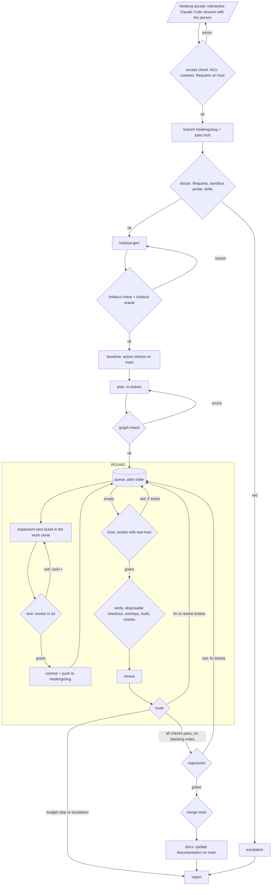

# Heideng v2 - Specification

Heideng (黑灯工厂, heideng gongchang, "lights-out factory") is a CLI that develops software from a spec with no people during the run. A person approves the spec before the run and reads the report after. In between, a fixed pipeline writes code ticket by ticket, verifies it against holdout checks the coding agents cannot see, and merges it into `main` only if verification passes.

- Input: an approved spec. Output: code merged into `main` and a report.
- A run works one spec on one project (a git repo). A project has at most one active run.
- The product builds, runs and passes verification on the person's machine, with the person's toolchain: a web app, an API, a CLI, a library or a native macOS app go through the same pipeline.
- Agents run only on Claude Code. Isolation is the OS sandbox of Claude Code for agents and of [`srt`](https://github.com/anthropics/sandbox-runtime) for the product's scripts.

## References

- Level 5 "dark factory" from Dan Shapiro's [The Five Levels](https://www.danshapiro.com/blog/2026/01/the-five-levels-from-spicy-autocomplete-to-the-software-factory/); holdout scenarios invisible to the agents from StrongDM's [Software Factory](https://factory.strongdm.ai).
- Skills the nodes run, by source:
  - [mattpocock/skills](https://github.com/mattpocock/skills): `to-tickets`, `tdd`, `diagnosing-bugs`, `code-review`, and the working vocabulary;
  - [obra/superpowers](https://github.com/obra/superpowers): `verification-before-completion`;
  - [DietrichGebert/ponytail](https://github.com/DietrichGebert/ponytail): `ponytail` and `ponytail-review`.
- Claude Code [sandboxing](https://code.claude.com/docs/en/sandboxing) and [permissions](https://code.claude.com/docs/en/permissions).

## Principles

1. **The engine decides the path, the agent does the work.** Routing is deterministic code over outcomes, counters and budgets. Inside a node the agent works with its own tool loop and returns structured output.
2. **Every loop has two stops.** Success comes from a check other than the worker. The budget stop closes the loop with a written reason: `patience` passes without progress, the `max_passes` cap, or the run's `usd` and `wall_clock`.
3. **The worker cannot see or change its verifier.** Holdout checks live in the `holdout` zone, outside the repo, which the OS sandbox denies to the build scope: the coding agents and every script they run. On a failed check the worker receives the check's intent and its output, never its code.
4. **Exit codes decide "done".** Build, test and holdout checks are scripts; their exit code is the verdict. LLM judges assess only what code cannot (holdout quality, code review), on a model different from the worker's.
5. **Everything heideng runs on the product is a script.** Build, test, start, ready and every holdout check are executables with a shebang, run on the host from a known directory with a known environment.
6. **One thing at a time.** Tickets run in sequence on one working clone, each on top of the previous ticket's commit. A red test has one candidate cause, the ticket in progress.
7. **The node boundary is the unit of durability.** After every node the engine saves state; a crash loses only the node in progress, which restarts from scratch on resume.
8. **The metric is cost per verified AC.** Total cost divided by the ACs whose holdout checks pass.

## Glossary

| Term | Meaning |
|---|---|
| Spec | Free-form document describing the change. After `accept` it is in `.heideng/specs/<slug>/spec.md` |
| AC | Acceptance criterion with a stable id (`AC-1`) in `acceptance.md`, marked `auto` or `manual` |
| Contract | `contract.md`: host prerequisites, product scripts, how checks drive and observe the product |
| Check | Holdout unit: `check.md` (ACs, intent, assertions) plus an executable `run`, optional `overlay/` |
| Overlay | Files a check adds to a disposable checkout before the build (test files compiled against the product) |
| Smoke | Engine step: `build`, `test`, `test-host` when the step runs it and `sandbox.unsandboxed` lists it, then `start` and `ready` when the product has them. Part of every test step, of the host step, of merge main and of docs. The test step runs `test-host` only for a ticket that fixes a red host step |
| Ticket | Unit of work. `T-<NN>` from the plan, `F-<n>` from failed checks or a red host step, `R-<n>` from blocking review notes |
| Plan | Ticket list approved by graph-check for one `spec.lock` version |
| Visit | One pass of a ticket through implement and test |
| Round | Tickets in sequence until the queue is empty, then host, verify and review |
| Work clone | The run's single git clone of `heideng/<slug>`, where every ticket is implemented |
| Scope | Isolation unit of a sandboxed execution, see [Scopes](#scopes) |
| Zone | `state`, `work` or `holdout`: a directory under `~/.heideng/` with one `<project>/` per project. Paths in this spec start with their zone: `state/runs/<run>/run.json` is `~/.heideng/state/<project>/runs/<run>/run.json` |
| Patience | Consecutive passes without progress a loop tolerates |
| Escalation | Problem the person must close before the run continues |

## Pipeline



| Node | Type | What |
|---|---|---|
| accept | llm, interactive | completes the spec with the person; writes spec, ACs, contract, decisions |
| accept check | tool | format of ACs and contract, Requires commands run on the host |
| doctor | tool | Requires commands, sandbox probe, skills of each node |
| holdout-gen | llm | checks from spec, ACs and contract, without the repo |
| holdout check | tool | traceability, executables, sections |
| holdout oracle | llm judge | coverage and non-trivial assertions |
| baseline | tool | checks of active specs on `main`; regression skips the red ones |
| plan | llm | `to-tickets` on a clone of the branch |
| graph-check | tool | acyclic, dependencies exist, every AC covered |
| implement | llm | one ticket in the work clone, sandboxed |
| test | tool | smoke in the work clone, under `srt` |
| host | tool | smoke with `test-host` in the work clone, once the queue is empty |
| verify | tool | holdout checks on a disposable checkout |
| review | llm judge | `code-review` and `ponytail-review` on the round diff |
| route | tool | new round, regression or stop |
| regression | tool | checks of active specs on the branch, minus baseline reds |
| merge main | tool | `git merge --no-ff heideng/<slug>` |
| docs | llm | documentation of the merged change, committed on `main` |
| report | tool + llm | `report.md`; the llm writes only the summary |

Every budget stop leads to report. An escalation on a ticket leaves the round running: the next runnable ticket starts, and route reports when nothing is runnable.

## Project interface

### Scripts

The product exposes itself to heideng through scripts in the repo.

| Script | Required | Exit 0 means |
|---|---|---|
| `.heideng/build` | yes | the product is built |
| `.heideng/test` | yes | the project's tests that run in the sandbox pass |
| `.heideng/test-host` | tests the sandbox cannot run | the project's other tests pass |
| `.heideng/start` | products with a long-running process | runs in the foreground until killed |
| `.heideng/ready` | with `start` | the started product accepts requests |

Execution rules, the same in every node:
- Run through the shebang, from the root of the checkout, under `srt` with the [product sandbox](#product-sandbox). A script listed in `sandbox.unsandboxed` runs without `srt`, with the same environment; the report lists it under "Isolation weakened".
- `.heideng/test-host` holds the tests the sandbox cannot run (a test runner service, launching the app, a pseudo-terminal); every test that runs in the sandbox stays in `.heideng/test`. The engine runs it only when `sandbox.unsandboxed` lists `test-host`, in the [host step](#host-tool), in the test step of a ticket that fixes a red host step, in merge main and in docs; otherwise smoke skips it and "To do for you" asks the person to add it. The worker writes the split and cannot run `test-host` itself; a sandbox restriction on tests makes it split them, never return blocked. The resolve session proposes the same split for an escalation caused by such a restriction.
- Environment: `HEIDENG_PORT` (a free port the engine picks), `HEIDENG_DATA` (an empty directory per execution), `HEIDENG_EVIDENCE` (directory for files the run keeps), `HOME` set to the [scope home](#scopes), [app secrets](#credentials-and-secrets) by script.
- Timeout 20 minutes per script; a timeout is red with the note "timeout".
- `start` runs in its own process group; the engine polls `ready` every second for 60 seconds, then kills the group at the end of the step.

### Contract

`contract.md` is in the repo and is cumulative. Each spec changes only the parts it touches; the delta enters `main` with the run's merge.

- **Requires.** One line per host prerequisite, as a command that exits 0 when the prerequisite holds: `` - Requires: `xcodebuild -version` ``, `` - Requires: `node -e "process.exit(+process.versions.node.split('.')[0] < 22)"` ``. The engine runs them on the host and inside the sandboxes.
- **Run.** Which of `start` and `ready` exist and what the product reads from the environment.
- **Drive.** What checks use to reach the product: routes, commands and exit codes, public modules and types, UI labels and accessibility identifiers, the overlay directories checks may write (`Tests/HoldoutTests/`). Overlay directories exist in the repo, empty, already wired into the build (a test target, a test glob), and `.heideng/test` does not run them. If a behavior depends on time, Drive declares the time control.
- **Observe.** Evidence a check reads: output, files under `HEIDENG_DATA`, DB rows.

### How checks reach the product

| Product | Check `run` | Overlay |
|---|---|---|
| HTTP API | `curl` on `localhost:$HEIDENG_PORT`, the product already started by the engine | none |
| Web UI | `npx playwright test` from the overlay directory | Playwright spec using contract locators |
| CLI | runs the built binary from `HEIDENG_APP_DIR`, reads stdout, exit code, files | none |
| Library | runs the project's test runner on the overlay test file | test file importing the public API |
| macOS app | `xcodebuild test -only-testing:HoldoutTests/<id>` | XCTest or XCUITest file in the overlay directory |

## Accept: `heideng accept <spec>`

One of the two steps where a person takes part; the other is [resolve](#resolve-heideng-resolve-id).

1. The engine prepares `state/accept/<slug>/` with a copy of the spec, `contract.md`, the `acceptance.md` of active specs and the accept prompt, and starts an interactive `claude` session there. The person and the agent talk directly.
2. The agent:
   - checks the spec against the contract sections and proposes what is missing (Requires, scripts, Drive, Observe);
   - lists the product choices the spec leaves open (language and version, dependencies, normalization of input, output formats, ordering tie-breaks, error precedence) and asks the person for each;
   - extracts the ACs with stable ids, each `auto` (a check can settle it) or `manual` (the person judges it after the run);
   - lists the ACs of active specs this spec modifies or removes;
   - writes `spec.md`, `acceptance.md`, `contract.md` and `decisions.md` in the directory;
   - tells the person to type `/exit` when satisfied.
3. When the session ends the engine runs the accept check:
   - ACs: unique ids, `auto` or `manual` on each, superseded ACs exist;
   - contract: the four sections, at least one Requires line, Drive lists the overlay directories;
   - every Requires command exits 0 on the host.
4. Errors: the engine prints them and `heideng accept <spec>` resumes the same session with the errors as the first message.
5. Ok: the engine asks `y/n`, creates `heideng/<slug>` from `main`, commits the four files under `.heideng/specs/<slug>/` (and `contract.md` at the root) and writes `spec.lock`: version, file hashes, superseded ACs. It copies the four files to `.heideng/accepted/<slug>/` in the project repo, ignored by git through `.heideng/accepted/.gitignore`, for the person to read before the run.

`heideng run` rejects a spec without a valid lock, a branch that does not start from `main`, a branch checked out in the project repo, or a spec already merged on this lock. A new `accept` on an open run increments the lock version and discards the plan; the next round plans on top of the branch.

## Holdout

```
holdout/<slug>/
  manifest.json        spec.lock hash, file hashes, oracle verdict
  <check-id>/
    check.md           ACs, Intent, Assertions
    run                executable, exit 0 = pass
    overlay/           optional, mirrors paths of the repo
holdout/retired/<slug>/<check-id>/   with the reason
```

- `check.md` has three sections. ACs lists the ids it covers. Intent describes the behavior in user terms and is the only text a worker may receive. Assertions describes what `run` verifies, for the oracle.
- An `auto` AC has at least one check. A check covers one or more ACs of its spec.
- Overlay paths fall under the overlay directories of the contract's Drive. An overlay file that would overwrite a file of the checkout makes the check red with "overlay collision", an escalation of kind `holdout`.

### Generation

- holdout-gen runs with cwd `holdout/<slug>/` and sees spec, `acceptance.md`, `contract.md`, `decisions.md` and the active holdout of other specs. It has no access to the repo.
- On a later spec it works on the contract delta and the superseded ACs: a modified AC gets rewritten checks, a removed AC moves its checks to `retired/`.
- Holdout check (tool): every `auto` AC covered, every cited AC exists, `run` executable with a shebang, `check.md` sections present, overlay under the declared directories.
- Holdout oracle: coverage and non-trivial assertions, on `check.md` and `run`. Output `{ ok, issues[], fixed }` through `--json-schema`. After `ok: false` the next judgment receives its issues and only the files changed since.
- Reuse: with the manifest validated for the current `spec.lock` hash and file hashes unchanged, the engine skips generation and oracle.
- Inside a run checks are immutable; verify rechecks the hashes before running them.

## Plan

- The plan node runs `/to-tickets <spec>` on a fresh clone of `heideng/<slug>`, sandboxed, with the rules:
  - every ticket has a `**Covers:** AC-1, AC-2` line;
  - the breakdown covers only what the code on the branch does not do yet;
  - without `.heideng/build` and `.heideng/test` on the branch, ticket `01` is the bootstrap: stack, the scripts of the contract's Run section, the overlay directories of the contract's Drive wired into the build, a skeleton and one test. Every other ticket depends on it.
- The engine converts the files into `T-<NN>` with `deps` from "Blocked by" and `ac` from Covers, and discards every other change in the clone.
- Graph-check: acyclic, dependencies exist, every AC (`auto` and `manual`) covered by a ticket, no ticket cites a missing AC. Errors resume the plan session.
- The engine stores the plan in `state/plans/<slug>/` under the `spec.lock` hash. A run with a valid plan skips the node; tickets whose commit is an ancestor of `heideng/<slug>` count as done.
- Execution order: topological, then by id.

## Round

### Work clone

- `work/runs/<run>/work` is a `git clone` of the project on `heideng/<slug>`. Only the engine runs git commands that write.
- Before each ticket the engine records the base sha. After a green test it commits the working tree as `<id>: <title>` and pushes to `heideng/<slug>` in the project repo.
- The engine resets a failed or blocked ticket with `git reset --hard <base>` and `git clean -fdx -e <cache dirs>`.

### Implement

- `claude -p` with cwd the work clone and the [worker sandbox](#worker-sandbox). Every visit is a new session.
- Prompt: ticket, spec, `acceptance.md`, `contract.md`, `decisions.md`, the execution rules of the scripts. With `visit > 1`, the compressed output of the previous red test.
- [Skills](#skills): `/tdd` on every visit, `diagnosing-bugs` with `visit > 1`, `verification-before-completion` before returning `done`. `/tdd` drives the loop and `ponytail` shapes the code of every green step, with the precedence stated in heideng's prompt:
  - test order and count follow `tdd`: red before green, one test per slice, only at the seams; `ponytail` adds no test of its own;
  - the seams come from the ticket and `acceptance.md`, and the agent records them in `decisions[]`;
  - `ponytail` decides the code of each green step: the first option of its ladder that makes the test pass;
  - no refactor inside the loop; cuts happen in the green step or in review through `ponytail-review`;
  - what `ponytail` skipped goes in `skipped[]`.
- Output: `{ status: done|blocked, summary, decisions[], skipped[] }`. The agent decides alone. Where ticket and documents do not decide, it takes the most conservative choice and records it in `decisions[]`. The engine appends them to the run's `decisions.md` and to the report.
- `blocked` marks the ticket `escalated`, its dependents `blocked`, and opens an escalation.
- A diff that touches `.heideng/*` outside the bootstrap is a mandatory note for review.

### Test (tool)

- Smoke in the work clone under `srt`. `test-host` runs only for a ticket whose `checks` hold `test-host`.
- Green: commit and next ticket.
- Red: the visit counter increments and implement runs again with the output compressed without an llm (failed tests with message and stack, repeated lines collapsed, otherwise the tail).
- `patience` visits without [progress](#stops-budgets-and-escalations) make the ticket `failed`: reset, dependents `blocked`, escalation of kind `ticket`, next runnable ticket.

### Host (tool)

- Runs when the queue is empty, no ticket is stuck and no escalation is open, when `.heideng/test-host` exists and `sandbox.unsandboxed` lists it.
- Smoke with `test-host` in the work clone, exec `r<n>/test-host`. The round keeps the head it went green on; the same head does not run it again, and the green test step of a `test-host` ticket counts as green on its commit.
- Green: verify.
- Red: one ticket `F-<n>` "smoke red at <script> with .heideng/test-host", `checks: [test-host]`, with the last 40 lines of the output, queued in the same round. Its visits run `test-host` in the test step; patience and `max_passes` apply as for every ticket.

### Verify (tool)

1. Holdout hashes match the manifest; a mismatch is an engine error.
2. Disposable checkout of `heideng/<slug>` in `holdout/runs/<run>/verify/r<n>/`, overlays of every check of the spec copied in. The checkout holds only the overlays; check `run` is never copied into it.
3. `build` on the checkout. Red: no check runs and the round ends with one ticket `F-<n>` "build red with holdout overlays". The engine removes from its build output every line that cites an overlay path or quotes overlay content, so the ticket keeps product files, missing symbols and compiler messages.
4. Each check in turn: `start` and `ready` when present, then `run` executed from its own holdout directory with `HEIDENG_APP_DIR` set to the checkout, stop. The exit code is the verdict.
5. A red check runs once more. Red then green is `flaky`, a verdict of its own that counts as fail.

Verdicts become fix tickets:
- One `F-<n>` per failed check with check id, ACs, Intent and the last 40 lines of `run` output, holdout paths replaced by `<holdout>`.
- A `flaky` check gets the same ticket with the output of both executions and the note "flaky: same code, two verdicts".
- Failed checks whose first error line is identical share one ticket.
- A check that fails in the next round again produces a new ticket with `supersedes` and the `summary` of the previous one.

The engine deletes the checkout and its scope home after the step. Verify reaches the work clone only through fix tickets.

### Review

- One `claude -p` session per round, model different from implement, on a clone of `heideng/<slug>`. The engine discards the changes it makes.
- `/code-review` on `base_round..heideng/<slug>`, with spec and `acceptance.md`; `ponytail-review` feeds the `lean` axis. Output `{ notes: [{ axis: spec|standards|lean, severity: blocking|minor, msg, files[] }] }`.
- Round 1: every `blocking` note becomes `R-<n>`. Later rounds: only `blocking` notes on the `spec` axis. Other notes go to the report.

### Route

- Fix or review tickets queued: new round.
- All checks pass and no ticket queued: regression. `manual` ACs never stop the run. The report lists them in "To do for you" and the person judges them on `main` after the merge.
- Nothing runnable and escalations open: report, exit code 1.

### Regression and merge into main

- Baseline, at run start: checks of active specs on a checkout of `main`. Regression skips the red ones and the report lists them.
- Regression: checks of active specs on the branch, like verify. Red: fix tickets and a new round.
- Merge into main: the run's `decisions.md` committed under `.heideng/specs/<slug>/`, then `git merge --no-ff heideng/<slug>`. If `main` moved, the engine merges `main` into the branch and repeats smoke, verify and regression first; a conflict or a red step is an escalation.

### Docs

Runs once, after the merge, on a clone of `main` in `work/runs/<run>/docs/`.

- `claude -p` with the [worker sandbox](#worker-sandbox), model from `nodes.docs`, on the clone. Prompt: spec, `acceptance.md`, `contract.md`, `decisions.md`, the merge diff `<merge base>..main` and the paths of `docs.paths`.
- The agent updates the documentation under `docs.paths` for the merged change: what the product does now, how to run and use it, the decisions that affect a user. It creates the files that do not exist. Output `{ summary, files[] }`.
- The engine keeps only the diff under `docs.paths` and discards the rest with a note in the report. With an empty diff the node ends with the note "no documentation change".
- Smoke on the clone with the diff applied. Green: commit `docs: <slug>` and push to `main`. Red: the diff is discarded, the report carries the smoke output under "Docs".
- A red or exhausted docs node never changes the outcome of the run. `main` keeps the merge and the report says what is missing.

## Isolation

### Worker sandbox

Every llm node runs `claude -p` on the host with settings generated per execution and passed with `--settings`, `--setting-sources ""`, `--permission-mode dontAsk`, `--allowedTools` of the node, `--plugin-dir` from [Skills](#skills), `--append-system-prompt-file` with the project's `CLAUDE.md` for the nodes listed in [Config](#config), `CLAUDE_CONFIG_DIR=state/runs/<run>/claude/`, `CLAUDE_CODE_DISABLE_AUTO_MEMORY=1`.

```json
{
  "sandbox": {
    "enabled": true,
    "failIfUnavailable": true,
    "allowUnsandboxedCommands": false,
    "excludedCommands": [],
    "filesystem": {
      "denyRead": ["~/.heideng/state", "<zones of the other scopes>", "<project repo>"],
      "allowRead": ["<cwd>", "<scope home>"],
      "allowWrite": ["<scope home>", "<sandbox.write from heideng.yaml, under the scope home>"]
    },
    "network": { "allowedDomains": ["<sandbox.allow from heideng.yaml>"], "allowLocalBinding": true }
  },
  "permissions": {
    "deny": ["Read(<each denied zone>/**)", "Edit(<each denied zone>/**)", "WebFetch", "WebSearch"]
  }
}
```

- `allowRead` reopens reading inside a denied directory; writing stays closed there. Every writable path of an execution (cwd, scope `HOME`, `sandbox.write`, `HEIDENG_DATA`, `HEIDENG_EVIDENCE`) therefore lies in the zone of its scope. A `denyRead` inside an allowed directory stays denied. The doctor probe verifies both directions.
- `excludedCommands` from `heideng.yaml` run outside the sandbox. The report lists them under "Isolation weakened".
- `sandbox.extra` from `heideng.yaml` is merged into the `sandbox` settings of every worker and into every srt settings file: objects merge, lists concatenate, any other value is set. It carries the sandbox options a toolchain needs and heideng does not model, such as `network.allowMachLookup` and `allowPty` for `xcodebuild test`. The report lists each of its leaves under "Isolation weakened".

### Skills

- heideng ships the skills it runs, vendored in `skills/<source>@<sha>/` with each source's LICENSE. `skills/manifest.yaml` records per source the repo, sha, license and file hashes, and per node its skills. A new sha comes only with a heideng release.
- At `run.start` the engine compares the vendored files with the manifest hashes. A mismatch is an engine error.

| Node | Skills |
|---|---|
| plan | `to-tickets`, `codebase-design`, `domain-modeling` |
| implement | `tdd`, `ponytail`, `diagnosing-bugs`, `verification-before-completion`, `codebase-design`, `domain-modeling` |
| review | `code-review`, `ponytail-review` |
| holdout-gen, oracle, docs, report | none |

- For each llm session the engine assembles a plugin with the node's skills and passes it with `--plugin-dir`. `--allowedTools` adds `Skill(<name>)` for each of them; under `dontAsk` every other skill is denied. `CLAUDE_CONFIG_DIR` holds no skills.
- `ponytail` loads in implement as its whole plugin, hooks included, with `PONYTAIL_DEFAULT_MODE=full` and `userConfig.ledger: false`. Review receives `ponytail-review` alone, without the plugin's hooks.
- In `-p` Claude Code expands only the first skill of the prompt. The prompt starts with the node's main skill (`/to-tickets`, `/tdd`, `/code-review`) and names the others, which the agent invokes with the Skill tool.

### Product sandbox

The engine runs every script of the product (build, test, start, ready) and every check `run` through `srt --settings <file>` with the same filesystem and network rules. Code written by an agent therefore runs with the same denials as the agent.

`srt/srt-<n>.json` in the scripts directory of the execution:

```json
{
  "filesystem": {
    "denyRead": ["~/.heideng/state", "<zones of the other scopes>", "<project repo>"],
    "allowRead": ["<cwd>", "<scope home>", "<extra read-only paths>"],
    "allowWrite": ["<cwd>", "<scope home>", "<scope home>/tmp", "<sandbox.write from heideng.yaml, under the scope home>", "<extra writable paths>"],
    "denyWrite": []
  },
  "network": { "allowedDomains": ["<sandbox.allow from heideng.yaml>"], "deniedDomains": [], "allowLocalBinding": true }
}
```

- srt (`@anthropic-ai/sandbox-runtime` >= 0.0.81) rejects a settings file missing any of these keys: every key is written, an empty list included. `srt --settings <srt-n.json> echo OK` prints `OK` on any generated file.

A check `run` executes from `holdout/<slug>/<id>/` with the write rules of the checkout it drives. Product code it loads (a test runner, a compiled overlay) can therefore read that check and write only inside the verify scope, which the engine deletes with the checkout.

### Scopes

Every sandboxed execution belongs to a scope. The scope owns a `HOME` and the only writable paths besides cwd and `TMPDIR`. Every `~`-relative entry of `sandbox.write` resolves under the scope's `HOME`. An entry `$NAME` names a **host directory**: a per-user directory of the host that toolchains write to outside `HOME` and `TMPDIR` (the OS user cache or user temp dir). It resolves to the host environment variable `NAME`, else to `getconf NAME`, and opens to every scope; build and verify share it, so the report lists it under "Isolation weakened". An entry that resolves to nothing, to a relative path, or to the real home or one of its ancestors stops the run. The person's real home stays readable and never writable.

| Scope | `HOME` | Executions | Lifetime |
|---|---|---|---|
| build | `work/runs/<run>/home/` | implement, plan, review, docs, report, the test and host steps, merge | the run |
| verify | `holdout/runs/<run>/verify/r<n>/home/` | `build`, `start`, `ready` and check `run` in verify, baseline and regression | the step |
| holdout | `holdout/home/` | holdout-gen, oracle | until the checks change |

The accept and resolve sessions belong to no scope: they run with the person, outside the sandbox, with the person's `HOME` and Claude Code config. The engine marks their staging folder as trusted in the person's `.claude.json` (`projects[<folder>].hasTrustDialogAccepted`), so the session opens without the trust dialog.

Each sandboxed scope writes in one zone and is denied the others:

| Zone | Contents | Writable by | Denied to |
|---|---|---|---|
| `state` | engine state, secret values, canary, plans, accept and resolve staging, node artifacts | the engine | every sandboxed scope |
| `work` | work clone, plan, review, docs and merge clones, build `HOME`, data and evidence of the build scope's smokes | build scope | holdout and verify scopes |
| `holdout` | checks, holdout `HOME`, verify checkouts and their `HOME`, check evidence | holdout and verify scopes | build scope |

### Audit

After every llm node the engine scans the tool calls in `stream.jsonl` for paths under `~/.heideng` outside the node's cwd and scope home. A hit voids the visit (reset of the work clone), emits a `leak` event and opens an escalation.

### Doctor

`heideng doctor` runs at `init`, at `accept` and at the start of every run:
- every Requires command, on the host, under `srt` and inside a probe Claude Code session with the worker settings;
- one probe session per zone a scope writes (`work/doctor/` with the build scope rules, `holdout/doctor/` with the holdout scope rules) runs `probe.sh` in its cwd, which writes `result.json`: a canary file under `state/` is unreadable with `cat` and with `python3`, a file in the cwd is readable, a write to the real home fails, a write under the scope `HOME` succeeds, a server on `localhost` answers; Claude Code denies the probe's Read tool call on the canary;
- one probe session per llm node with the node's flags and `--max-turns 1`: in the `system/init` event `skills` equals the node's list in the manifest, `plugins` holds only the node's plugin, `plugin_errors` is absent; for implement a `hook_response` of the ponytail SessionStart hook follows.

A red doctor stops before any node, with the failing command and the setting that resolves it (`sandbox.write`, `sandbox.allow`, `sandbox.excluded`), or the missing or extra skill.

### Credentials and secrets

- The llm nodes authenticate from the environment of `heideng`: `CLAUDE_CODE_OAUTH_TOKEN` (from `claude setup-token`) or `ANTHROPIC_API_KEY`, the only credential that reaches a run's fresh `CLAUDE_CONFIG_DIR`.
- App secrets: names in `.heideng/env`, values in `state/env`. The engine injects the values into `start`, `ready` and check `run`. Agents, `build` and `test` see only the names, so `build` and `test` give the worker and the engine the same result.

## Stops, budgets and escalations

| Loop | Success stop | Progress |
|---|---|---|
| `rounds` | checks and regression green | the set of failed checks changes; with none failing, fewer tickets queued |
| `visits` | test green | the set of failing tests or the first error line changes |
| `holdout-oracle` | `ok: true` | `fixed >= 1` |
| `holdout-check`, `graph-check` | all checks pass | the set of errors changes |

- `patience` passes without progress or `max_passes` stop the loop with an escalation. Escalation kinds: `ticket` (blocked or failed ticket), `holdout` (overlay collision), `doctor`, `merge`, `budget`, `leak`.
- `usd` and `wall_clock` bound the run; `wall_clock` counts only the time the engine is running.
- The engine repeats an llm call with an API or network error up to 2 times with backoff. Beyond that the run stops with exit code 4.
- An llm call that exhausts its per-call limit (`--max-budget-usd`, turns, timeout) counts as a red visit for implement, `ok: false` for the oracle, a new pass for holdout-gen and plan, no notes for review.
- The engine writes each escalation from a template in `state/runs/<run>/escalations/<id>.md`, with what, why, evidence and how to close.
- Closing: `heideng resolve <id>`, below.
- `heideng resume` gives the exhausted limit a new allowance equal to its configured value; `--add-usd`, `--add-time`, `--add-passes` set a precise one. It closes the open budget escalations and records the command under `## Resolved`.

### Resolve: `heideng resolve <id>`

The person closes an escalation together with an agent, which reads the state files for them.

1. The engine prepares `state/resolve/<id>/` with `escalation.md`, `spec/` (the accepted `spec.md`, `acceptance.md`, `contract.md` and `decisions.md` of `heideng/<slug>`, with the `active/` ACs) and the resolve prompt, and starts an interactive `claude` session there. The session reads the run directory and the holdout checks of the spec where they are.
2. The agent:
   - reads the evidence and explains the cause to the person;
   - agrees a closure with the person;
   - writes `resolution.md`, and edits the files in `spec/` when the closure changes the spec or the contract;
   - tells the person to type `/exit` when satisfied.
3. Closures, combinable:
   - `## Note` in `resolution.md`: a decision appended to the run's `decisions.md`; for a `ticket` escalation the ticket is requeued;
   - `## Budget` in `resolution.md`: lines `- add-usd: <n>`, `- add-time: <duration>`, `- add-passes: <n>`, with the meaning of the `resume` flags;
   - spec: the files in `spec/` differ from the accepted ones.
4. When the session ends the engine runs the resolve check:
   - at least one closure;
   - changed spec files pass the accept check;
   - every budget line is valid;
   - the note contains no line of the Assertions section or of `run` of the spec's holdout checks (shebangs and lines under 12 characters aside), because workers read `decisions.md`.
5. Errors: the engine prints them and the next `heideng resolve <id>` resumes the same session with the errors as the first message.
6. Ok: the engine asks `y/a/n`, or `y/n` while another escalation of the run is open. On `n` nothing changes. On `y` or `a` it commits changed spec files on `heideng/<slug>` with a new lock version (the plan is discarded) and refreshes `.heideng/accepted/<slug>/`, appends the note to `decisions.md`, records under `## Resolved` of the escalation the note, the budget lines and the lock version, closes the escalation, requeues its ticket and grants the budget allowances to the run. With another escalation open it prints the ones still open. On `a` it prints `heideng resume <run>`. On `y` it resumes the run in a new `heideng resume <run>` process, which loads the current heideng code.

## State and resume

```
~/.heideng/state/<project>/
  run.lock                    pid of the engine, run id
  env                         app secret values
  canary                      read by the doctor probe
  plans/<slug>/               tickets, spec.lock hash
  accept/<slug>/              staging of the accept session
  resolve/<id>/               staging of the resolve session
  runs/<run>/
    run.json                  state and cursor, written after every node (tmp + fsync + rename)
    events.jsonl              append-only log
    decisions.md
    report.md
    tickets/<id>.md
    escalations/<id>.md
    claude/                   CLAUDE_CONFIG_DIR of the run (sessions)
    nodes/<exec>/             prompt.md, stream.jsonl, response.json, status.json, test.log, settings
~/.heideng/work/<project>/
  doctor/                     cwd and HOME of the doctor probe for the build scope
  runs/<run>/
    work/                     the work clone
    plan/, review/r<n>/       clones of the branch for plan and review
    report/                   cwd of the report node
    docs/, merge/             clones of main for the docs node and the merge, deleted after the step
    home/                     HOME of the build scope, toolchain caches
    scripts/<exec>/           HEIDENG_DATA and HEIDENG_EVIDENCE of the smokes of the build scope (test step, host step, docs, merge)
~/.heideng/holdout/<project>/
  home/                       HOME of the holdout scope
  <slug>/, retired/           checks
  doctor/                     cwd and HOME of the doctor probe for the holdout scope
  runs/<run>/
    verify/r<n>/              disposable checkout and its home/, deleted after verify
    verify-work/r<n>/         HEIDENG_DATA of the verify scope
    evidence/<check>/         output of each check run
```

- `exec` is the deterministic key of a node execution: `r<n>/<ticket>/v<n>`, `r<n>/test-host`, `r<n>/verify`, `r<n>/review`, `holdout/v<n>`, `plan/v<n>`, `regression`, `merge-main`, `docs`, `report`.
- Ticket state in `run.json`: `queued|implementing|done|failed|escalated|blocked`, visit, base sha, commit sha.
- Ctrl-C (SIGINT) on the engine kills the node in progress and ends the run as `stopped` with reason `interrupted`, exit code 3; `heideng resume` continues it. SIGTERM, which `heideng abort` sends, ends it as `aborted`.
- `heideng resume` restarts the node in progress. It resets an `implementing` ticket to its base sha, checks a `done` ticket with `git merge-base --is-ancestor`, and restarts verify, review and regression from scratch.
- Before writing any file the engine replaces secret values with `***`.

### Events

One JSON object per line: `{ v, seq, ts, type, exec, ticket?, visit?, round?, data }`.

| type | data |
|---|---|
| `run.start` | spec, `spec.lock` hash, config hash, heideng and Claude Code versions, skill shas |
| `run.end` | `merged\|stopped\|aborted\|failed`, reason |
| `node.start` / `node.end` | kind, model; outcome, usd, duration |
| `ticket.status` | from, to, reason |
| `commit` | ticket or `docs`, sha |
| `verdict` | check, ACs, round, `pass\|fail\|flaky`, evidence |
| `decision` | text, ticket |
| `leak` | exec, path |
| `escalation` | id, kind, reason |
| `stop` | loop, kind, reason |

## Report

`state/runs/<run>/report.md`, "To do for you" first.

```markdown
# <spec> - run <id>
Outcome: merged <sha>, docs <sha> | stopped: <reason> | aborted | failed
Branch heideng/<slug> - round 3 - $27.80 / 50 - 5h12 / 6h - $2.10 per verified AC

## To do for you
- [ ] E-1: <reason> -> heideng resolve E-1
- [ ] manual AC-7: <text>
- [ ] decision (T-03): <text>

## Checks
| check | ACs | R1 | R2 | R3 |
## Tickets
| id | source | outcome | visits | cost |
## Review notes
## Docs
## Isolation weakened
## Decisions
## Costs
## Summary
```

`heideng stats` aggregates the reports and computes the cost per verified AC.

## CLI

| Command | What it does |
|---|---|
| `heideng init` | writes `heideng.yaml`, empty `contract.md`, `.heideng/env`; runs doctor |
| `heideng doctor` | Requires, sandbox probe, skills of each node |
| `heideng accept <spec>` | interactive session, accept check, branch and lock |
| `heideng run <spec>` | runs the pipeline; `--until holdout\|plan\|round\|merge` stops at that boundary |
| `heideng resume [run]` | continues a stopped run; `--add-usd`, `--add-time`, `--add-passes` |
| `heideng resolve <id>` | interactive session, resolve check, closure of the escalation, resume on `y` |
| `heideng abort [run]` | stops the engine at once and ends the run as `aborted`, branch unchanged; an aborted run cannot be resumed |
| `heideng close <run>` | releases the lock; branch and plan stay. `--delete-branch` deletes both and retires the checks |
| `heideng status` | active run, current node, open escalations |
| `heideng stats` | cost per run and per verified AC |

During `run` and `resume`, on a terminal, stderr shows an in-place view redrawn as events arrive: the phase graph `holdout -> baseline -> plan -> rounds -> merge -> docs -> report` with a spinner on the active phase, the node in progress (what it does, exec, model, elapsed, retries), the tickets with their state, spent against limits, and the last events. Off a terminal stderr shows one line per event: `<time> <exec> <type> <outcome> <cost>`. At the end stdout prints outcome, budgets, "To do for you" and the path of the report.

Exit codes: 0 merged or command succeeded, 1 stopped with escalation, 2 budget stop, 3 aborted or interrupted, 4 engine error, 5 rejected (invalid lock, active run, failed doctor).

## Config

`heideng.yaml` in the repo root:

```yaml
sandbox:
  allow: [registry.npmjs.org]                        # network for agents and product scripts
  write: [~/.npm]                                    # toolchain caches, resolved under the scope HOME; $NAME opens the host directory NAME (env var, else getconf) to every scope
  excluded: []                                       # commands run outside the sandbox, reported
  extra: {}                                          # sandbox options merged into worker and srt settings, reported
  unsandboxed: []                                    # product scripts run without srt (e.g. test-host), reported
docs:
  paths: [README.md, docs/]                          # the only paths the docs node may change
budgets: { usd: 50, wall_clock: 6h, patience: 2, max_passes: 10 }
nodes:
  accept:    { model: opus }
  holdout:   { model: opus }
  oracle:    { model: sonnet }
  plan:      { model: opus }
  implement: { model: sonnet, effort: medium }
  review:    { model: opus }
  docs:      { model: sonnet }
```

The project customizes the agents through the `CLAUDE.md` at the root of the node's clone, passed to plan, implement, review and docs with `--append-system-prompt-file`. heideng's prompt names the phase; `CLAUDE.md` can point to `.heideng/plan.md`, `.heideng/implement.md`, `.heideng/review.md`, `.heideng/docs.md`.

## Testability

`HEIDENG_CLAUDE_BIN` replaces `claude` with a stub that returns stream-json and `structured_output`. `HEIDENG_SRT_BIN` replaces `srt`. Tests drive the heideng binary on fixture repos with real git and real scripts; the doctor probe runs against the real `claude` and `srt` in a separate suite.
